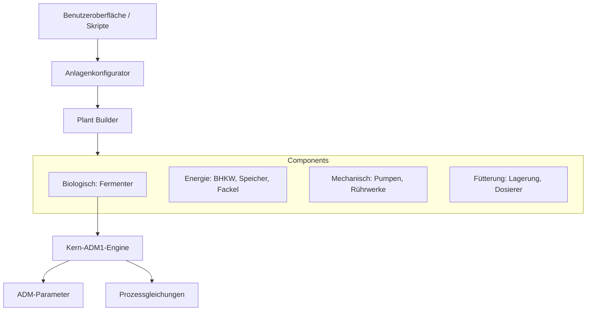
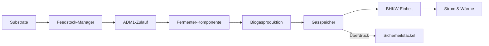
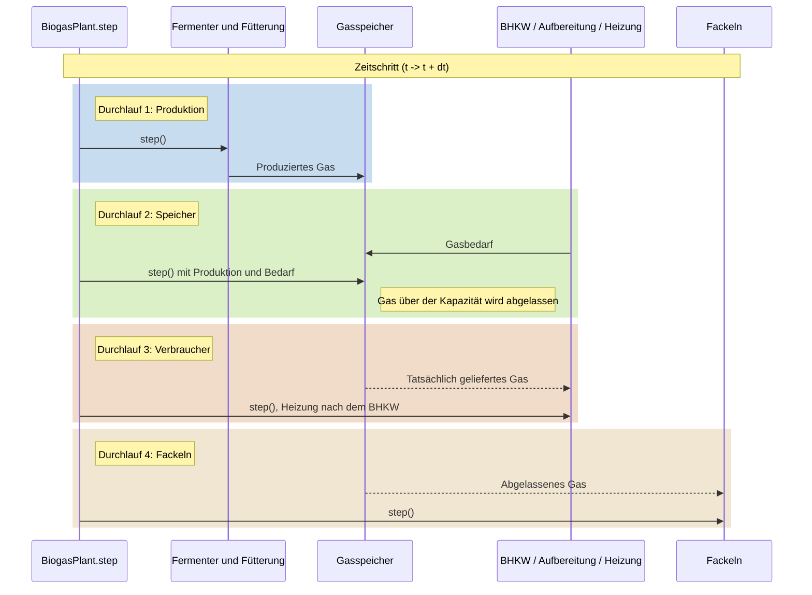

# Architektur

Diese Seite beschreibt die Systemarchitektur und den Datenfluss von PyADM1ODE.

## Systemübersicht

Das Framework besteht aus mehreren modularen Schichten:

## Datenfluss

## Simulationsschritt in vier Durchläufen

Gasverbraucher hängen davon ab, was die Speicher liefern können, und
Heizsysteme von der Wärme des BHKW. `BiogasPlant.step` führt deshalb jeden
Zeitschritt in vier Durchläufen aus; jede Komponente wird genau einmal
berechnet.

