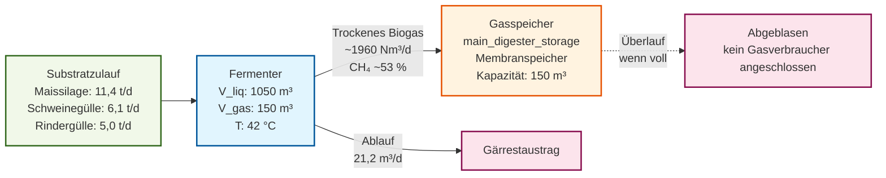

# Basis-Fermenter Beispiel

[](https://colab.research.google.com/github/dgaida/PyADM1ODE/blob/master/examples/colab_01_basic_digester.ipynb)

Das Beispiel
[`examples/01_basic_digester.py`](https://github.com/dgaida/PyADM1ODE/blob/master/examples/01_basic_digester.py)
ist die einfachste PyADM1ODE-Konfiguration: ein einzelner Fermenter, der mit
drei Substraten gefüttert wird, zusammen mit dem Gasspeicher, den der
Konfigurator dazu anlegt. Das Colab-Notebook rechnet eine verkürzte Variante
(zwei Substrate, ein größerer Fermenter, 5 Tage); seine Zahlen weichen daher
von denen auf dieser Seite ab.

## Systemarchitektur



## Übersicht

Das Beispiel zeigt:

- Substrate aus der mitgelieferten Bibliothek über ihre ID wählen und die Mischung als Dict `{substrate_id: Fütterungsmenge}` angeben  
- Eine Anlage mit einem Fermenter mit dem `PlantConfigurator` aufbauen  
- Den Gasspeicher, den `add_digester()` als eigene Komponente anlegt  
- Start aus einem Anfangszustand, der aus der Substratmischung abgeleitet wird, ohne Zustandsdatei  
- 150 Tage in Tagesschritten simulieren  
- Biogas, Methan, Methangehalt und pH-Wert für jeden zehnten Tag ausgeben  
- Die Anlage mit ihrem Endzustand als JSON speichern  

## Anlagenkonfiguration

| Komponente | ID | Einstellungen |
| --- | --- | --- |
| Fermenter | `main_digester` | 1050 m³ Flüssigkeitsvolumen, 150 m³ Gasraum, 42 °C (315,15 K) |
| Gasspeicher | `main_digester_storage` | Membranspeicher, 150 m³ Kapazität; von `add_digester()` angelegt |

Die Fütterung ist das `DEFAULT_FEED` des Skripts:

| Substrat-ID | Material | Fütterungsmenge |
| --- | --- | --- |
| `maize_silage_milk_ripeness` | Maissilage (Milchreife) | 11,4 t/d |
| `swine_manure` | Schweinegülle | 6,1 t/d |
| `cattle_manure` | Rindergülle | 5,0 t/d |
| Summe | | 22,5 t/d |

**Einheit der Fütterungsmengen**: Mit der Standardkonvention des `Feedstock`
(`simba_q_convention=True`) sind die Fütterungsmengen Tonnen Frischmasse pro
Tag (t FM/d). Für die beiden Güllen (Dichte 1000 kg/m³) entspricht eine Tonne
einem Kubikmeter; die 11,4 t/d Maissilage (Dichte 1129 kg/m³) nehmen
10,1 m³/d ein. Der Fermenter erhält damit
21,2 m³/d, und die hydraulische Verweilzeit beträgt
1050 m³ ÷ 21,2 m³/d ≈ **49,5 d**. Siehe
[Volumetrische ADM1da-Konvention für Q](../user_guide/adm1_implementation.md#volumetrische-adm1da-konvention-fur-q).

**Gasspeicher**: Der Fermenter hat keinen eigenen Gasspeicher; `V_gas` ist nur
der Gasraum der ADM1-Gasphase. `add_digester()` legt eine eigene Komponente
`GasStorage` mit dem Namen `<digester_id>_storage` an, hier
`main_digester_storage`, und verbindet sie über eine Gasverbindung mit dem
Fermenter. Ihre Kapazität ist `max(50, V_gas)`, hier 150 m³. Das Beispiel hat
kein BHKW und keinen anderen Gasverbraucher, dem Speicher wird also nichts
entnommen: Er ist nach dem ersten Tag voll und bläst von da an die gesamte
Produktion ab (siehe [Konfigurationsexport](#konfigurationsexport)). Die
Komponente ist unter
[Gasspeicher](../user_guide/components/energy.md#gasspeicher) beschrieben.

## Code-Durchgang

Die Ausschnitte stammen aus dem Skript.

### 1. Substratmischung

```python
# Default substrate mix [t FM/d] — maize silage + swine + cattle manure.
DEFAULT_FEED: dict[str, float] = {
    "maize_silage_milk_ripeness": 11.4,
    "swine_manure": 6.1,
    "cattle_manure": 5.0,
}
```

Jeder Schlüssel ist die ID einer Substratdatei unter
[`data/substrates/`](https://github.com/dgaida/PyADM1ODE/tree/master/data/substrates),
also der Dateiname ohne Endung (siehe
[Beispiel-Substrate](../substrates/library.md)). Es können beliebig viele
Substrate angegeben werden. `main(feed=...)` nimmt eine andere Zuordnung
derselben Form entgegen und teilt sie in zwei Listen:

```python
substrate_ids = list(feed.keys())
Q_substrates = list(feed.values())
```

### 2. Feedstock und Anlage

```python
from pyadm1 import BiogasPlant, Feedstock
from pyadm1.configurator.plant_configurator import PlantConfigurator
```

```python
feedstock = Feedstock(substrate_ids, feeding_freq=24, total_simtime=160)
plant = BiogasPlant("ADM1 Basic Plant")
cfg = PlantConfigurator(plant, feedstock)
```

- `Feedstock` lädt die genannten Substrate und berechnet aus ihren Laborwerten den ADM1-Zulauf. `feeding_freq` ist die Zeit zwischen zwei Fütterungen in Stunden, `total_simtime` die Länge seines Zeitrasters in Tagen.  
- `BiogasPlant` ist der Container für alle Komponenten und ihre Verbindungen.  
- `PlantConfigurator` fügt Komponenten mit Standardwerten hinzu und verbindet sie.  

### 3. Fermenter

```python
cfg.add_digester(
    digester_id="main_digester",
    V_liq=1050.0,
    V_gas=150.0,
    T_ad=315.15,
    Q_substrates=Q_substrates,
    k_L_a=200.0,
)
plant.initialize()
```

| Argument | Wert | Bedeutung |
| --- | --- | --- |
| `V_liq` | 1050 m³ | Flüssigkeitsvolumen |
| `V_gas` | 150 m³ | Gasraum |
| `T_ad` | 315,15 K | Betriebstemperatur (42 °C) |
| `Q_substrates` | `[11.4, 6.1, 5.0]` | Fütterungsmengen, in der Reihenfolge der Substrat-IDs |
| `k_L_a` | 200 d⁻¹ | Stoffübergangskoeffizient Gas–Flüssigkeit |

Die Volumina und die Temperatur entsprechen den Standardwerten von
`add_digester()`, und 200 d⁻¹ ist auch der Modellstandard für `k_L_a`.

`add_digester()` erledigt drei Dinge:

- Es legt den Fermenter an und leitet seinen Anfangszustand aus dem Feedstock ab: einen angeimpften Zustand bei pH 7 mit aktiver Biomasse, passend zu dieser Substratmischung und Fütterungsmenge. Eine Zustandsdatei ist nicht nötig.  
- Es legt den Gasspeicher `main_digester_storage` an.  
- Es verbindet Fermenter und Speicher über eine Gasverbindung.  

Zurückgegeben werden der Fermenter und eine einzeilige Beschreibung des
Anfangszustands; das Skript nutzt den Rückgabewert nicht.
`plant.initialize()` initialisiert jede Komponente, die noch nicht
initialisiert ist.

### 4. Simulation

```python
results = plant.simulate(duration=150.0, dt=1.0, save_interval=1.0)
```

- `duration`: simulierte Zeit [d]  
- `dt`: Zeitschritt der Anlage [d]. In jedem Schritt wird zuerst der Fermenter gerechnet, dann erhält der Gasspeicher dessen Produktion. Innerhalb des Schritts integriert der Fermenter die ADM1-Gleichungen mit dem BDF-Löser von SciPy und adaptiver Schrittweite.  
- `save_interval`: Abstand der gespeicherten Ergebnisse [d]  

`results` enthält 150 Einträge, einen pro Tag, mit `time` von 1,0 bis 150,0.
Jeder Eintrag hat die Form
`{"time": ..., "components": {component_id: outputs}}`.

### 5. Auswertung

```python
times = np.array([r["time"] for r in results])
dig = [r["components"]["main_digester"] for r in results]
q_gas = np.array([c["Q_gas"] for c in dig])
q_ch4 = np.array([c["Q_ch4"] for c in dig])
pH = np.array([c["pH"] for c in dig])
```

`Q_gas` und `Q_ch4` sind **trockenes Gas im Normzustand** (0 °C,
1,01325 bar), in Nm³/d; der Wasserdampf des Gasraums gehört nicht dazu. Siehe
[Gemeldete Gasströme](../user_guide/adm1_implementation.md#gemeldete-gasstrome).

```python
# The first saved result is the end of day 1; then every tenth day and the last.
for day in sorted({int(times[0]), *range(10, int(times[-1]) + 1, 10), int(times[-1])}):
    i = int(np.argmin(np.abs(times - day)))
    ch4p = q_ch4[i] / q_gas[i] * 100.0 if q_gas[i] > 0.0 else 0.0
    print(f"{day:>5d}  {q_gas[i]:>10.1f}  {q_ch4[i]:>10.1f}  {ch4p:>6.1f}  {pH[i]:>6.2f}")
```

Die Tabelle hat eine Zeile für das Ende von Tag 1, für jeden zehnten Tag und
für den letzten Tag. Die Spalte `CH4%` ist `Q_ch4 / Q_gas`, der Methangehalt
des trockenen Gases. Für Tag 0 gibt es kein Ergebnis, weil das erste nach dem
ersten Schritt gespeichert wird.

### 6. Speichern

```python
output_path = REPO_ROOT / "output"
output_path.mkdir(exist_ok=True)
plant.to_json(str(output_path / "quickstart_config.json"))

return plant, results
```

## Ausgabe

`python examples/01_basic_digester.py`, aus dem Wurzelverzeichnis des
Repositorys gestartet, gibt aus (Zeilen für die Tage 80 bis 130 und der Anfang
des Pfads ausgelassen):

```text
Substrate mix:
  maize_silage_milk_ripeness           11.40 t FM/d
  swine_manure                          6.10 t FM/d
  cattle_manure                         5.00 t FM/d
  TOTAL                                22.50 t FM/d

Simulated 100/150 steps
  Day      Biogas     Methane    CH4%      pH
--------------------------------------------------
    1      1765.6       870.0    49.3    7.38
   10      1894.4      1009.7    53.3    7.42
   20      1926.0      1026.3    53.3    7.43
   30      1943.8      1035.3    53.3    7.45
   40      1953.1      1039.5    53.2    7.46
   50      1957.4      1040.9    53.2    7.46
   60      1959.1      1040.9    53.1    7.46
   70      1959.7      1040.5    53.1    7.46
...
  140      1959.7      1039.2    53.0    7.45
  150      1959.7      1039.2    53.0    7.45
Plant configuration saved to ...\PyADM1ODE\output\quickstart_config.json
```

Die Zeile `Simulated 100/150 steps` ist eine Fortschrittsmeldung von
`plant.simulate()`.

## Ausgabe interpretieren

| Größe | Wert an Tag 150 | Ermittelt aus |
| --- | --- | --- |
| Biogas (trocken) | 1959,7 Nm³/d | `Q_gas` |
| Methan | 1039,2 Nm³/d | `Q_ch4` |
| Methangehalt des trockenen Gases | 53,0 % | `Q_ch4 / Q_gas` |
| pH-Wert | 7,45 | `pH` |
| Biogas je Tonne Frischmasse | 87,1 Nm³/t | 1959,7 Nm³/d ÷ 22,5 t/d |
| Methan je Tonne Frischmasse | 46,2 Nm³/t | 1039,2 Nm³/d ÷ 22,5 t/d |

Verlauf über die 150 Tage:

- **Start**: Die erste Zeile (Ende von Tag 1) zeigt 1765,6 Nm³/d Biogas mit 49,3 % Methan. An Tag 10 liegt der Methangehalt bei 53,3 %.  
- **Biogas**: Es steigt bis Tag 70 auf 1959,7 Nm³/d und bleibt dort.  
- **Methan**: Es erreicht 1040,9 Nm³/d an Tag 50 und pendelt sich bei 1039,2 Nm³/d ein. Der Methangehalt sinkt von 53,3 % auf 53,0 %.  
- **pH-Wert**: Er steigt von 7,38 auf 7,46 und bleibt ab Tag 30 zwischen 7,45 und 7,46.  

### Weitere Werte in den Ergebnissen

Jeder gespeicherte Eintrag enthält die vollständige Ausgabe beider
Komponenten. Sie lassen sich am Ende von `main()` oder aus dessen Rückgabewert
lesen:

```python
last = results[-1]["components"]
digester = last["main_digester"]
storage = last["main_digester_storage"]

print(digester["VFA"], digester["TAC"], digester["HRT"])
print(storage["stored_volume_m3"], storage["vented_volume_m3"])
```

| Schlüssel | Bedeutung | Wert an Tag 150 |
| --- | --- | --- |
| `Q_co2` | Kohlendioxid, trocken [Nm³/d] | 920,5 |
| `VFA` | Flüchtige Fettsäuren [g HAc-eq/L] | 2,60 |
| `TAC` | Säurekapazität [g CaCO₃/L] | 6,78 |
| `TS` | Trockensubstanz [% FM] | 10,6 |
| `HRT` | Gefilterte hydraulische Verweilzeit [d] | 47,1 |
| `Q_out` | Ablauf [m³/d] | 21,2 |

`HRT` folgt einer Verzögerung erster Ordnung in Richtung der oben genannten
49,5 d und hat an Tag 150 den Wert 47,1 d erreicht.

Gasstrom und pH-Wert wirken nach 70 Tagen eingeschwungen, die Säuren sind es
nicht: VFA steigt von 0,24 g/L am Ende von Tag 1 auf 1,96 g/L an Tag 100 und
2,60 g/L an Tag 150, während TAC von 7,40 auf 6,78 g CaCO₃/L fällt. Innerhalb
der 150 Tage hat der Fermenter also keinen vollständig stationären Zustand
erreicht. Typische Betriebsbereiche dieser Kennwerte stehen unter
[Prozessüberwachung](../user_guide/components/biological.md#prozessuberwachung).

## Konfigurationsexport

`plant.to_json()` schreibt den Aufbau der Anlage und ihren Zustand am Ende des
Laufs nach `output/quickstart_config.json`. Gekürzt lautet die Datei:

```json
{
  "plant_name": "ADM1 Basic Plant",
  ...
  "substrate_use": {
    "maize_silage_milk_ripeness": {
      "mass_t": 1710.000000000004,
      "cost": 68399.99999999999
    },
    ...
  },
  "simulation_time": 150.0,
  "components": [
    {
      "component_id": "main_digester",
      "component_type": "digester",
      "name": "main_digester",
      "V_liq": 1050.0,
      "V_gas": 150.0,
      "T_ad": 315.15,
      ...
      "calibration_parameters": {
        "k_L_a": 200.0
      },
      ...
      "state": {
        "adm1_state": [...],
        "Q_substrates": [
          11.4,
          6.1,
          5.0
        ],
        "Q_gas": 1959.7029555067936,
        "Q_ch4": 1039.157036397983,
        "Q_co2": 920.5338387696268,
        "pH": 7.452384393187586,
        "VFA": 2.599257770172284,
        "TAC": 6.775870356966873,
        "TS": 10.635918532942508,
        "HRT": 47.13833332586989,
        "V_liq": 1050.0
      },
      "component_class": "Digester"
    },
    {
      "component_id": "main_digester_storage",
      "component_type": "storage",
      "name": "main_digester Gas Storage",
      "storage_type": "membrane",
      "capacity_m3": 150.0,
      ...
      "stored_volume_m3": 150.0,
      "ch4_fraction": 0.5302625700153639,
      "co2_fraction": 0.4697312655990599,
      ...
      "cumulative_vented_m3": 291889.75429776055,
      "outputs_data": {
        "stored_volume_m3": 150.0,
        "pressure_bar": 1.05,
        "utilization": 1.0,
        "vented_volume_m3": 1959.7029555067938,
        "Q_gas_supplied_m3_per_day": 0.0,
        ...
      },
      ...
      "component_class": "GasStorage"
    }
  ],
  "connections": [
    {
      "from": "main_digester",
      "to": "main_digester_storage",
      "type": "gas"
    }
  ]
}
```

- `substrate_use` ist die über den Lauf gefütterte Frischmasse und ihre Kosten: 11,4 t/d × 150 d = 1710 t Maissilage.  
- `state` des Fermenters enthält die 41 ADM1-Zustandsgrößen und die Kennwerte des letzten Schritts.  
- Der Eintrag des Speichers zeigt, wohin das Gas ging: Der Speicher ist voll (150 m³ von 150 m³), hat nichts abgegeben (`Q_gas_supplied_m3_per_day` ist 0) und die Produktion des letzten Tages abgeblasen (1959,7 m³). Über den Lauf hat er 291 890 m³ abgeblasen (`cumulative_vented_m3`).  

Die Datei lässt sich wieder laden, um vom gespeicherten Zustand aus
weiterzurechnen. Der Feedstock ist nicht darin gespeichert und muss übergeben
werden, mit den Substraten in derselben Reihenfolge:

```python
from pyadm1 import BiogasPlant, Feedstock

feedstock = Feedstock(
    ["maize_silage_milk_ripeness", "swine_manure", "cattle_manure"],
    feeding_freq=24,
    total_simtime=160,
)
plant = BiogasPlant.from_json("output/quickstart_config.json", feedstock)
```

## Beispiel anpassen

- **Substratmischung**: `DEFAULT_FEED` ändern oder ein anderes Dict an `main(feed=...)` übergeben. Einträge können ergänzt oder entfernt werden; jeder Schlüssel muss eine Substrat-ID der [Bibliothek](../substrates/library.md) sein.  
- **Fermenter**: `V_liq`, `V_gas` oder `T_ad` in `cfg.add_digester(...)` ändern. `T_ad` wird in Kelvin angegeben.  
- **Dauer und Zeitschritt**: `duration`, `dt` und `save_interval` in `plant.simulate(...)` ändern, zum Beispiel `dt=1.0 / 24.0` für stündliche Anlagenschritte.  
- **Weitere Ausgaben**: VFA, TAC oder die Speicherwerte aus `results` lesen, siehe [Weitere Werte in den Ergebnissen](#weitere-werte-in-den-ergebnissen).  
- **Gasverwertung**: Ein BHKW und eine Heizung ergänzen, siehe [Zweistufige Anlage](two_stage_plant.md) und [Energiekomponenten](../user_guide/components/energy.md).  

## Referenzen

- **Batstone, D. J. et al. (2002).** *Anaerobic Digestion Model No. 1 (ADM1).* IWA Scientific and Technical Report No. 13. IWA Publishing, London.  
- **Schlattmann, M. (2011).** *Weiterentwicklung des Anaerobic Digestion Model No. 1 (ADM1) zur Anwendung auf landwirtschaftliche Substrate.* Dissertation, Technische Universität München. Dies ist das Modell ADM1da, das der Fermenter umsetzt.  
- Die vollständige Liste steht auf der Seite [Referenzen](../user_guide/references.md).  

## Verwandte Seiten

- [Zweistufige Anlage](two_stage_plant.md): zwei Fermenter in Reihe mit BHKW und Heizung  
- [Parallele Simulation](parallel_simulation.md): viele Simulationen eines Fermenters nebeneinander  
- [Biologische Komponenten](../user_guide/components/biological.md): Parameter und Ausgaben des Fermenters  
- [Energiekomponenten](../user_guide/components/energy.md): Gasspeicher, BHKW, Heizung, Fackel  
- [ADM1-Implementierung](../user_guide/adm1_implementation.md): das Modell hinter dem Fermenter  
- [Troubleshooting](../user_guide/troubleshooting.md): häufige Probleme und ihre Lösungen  
