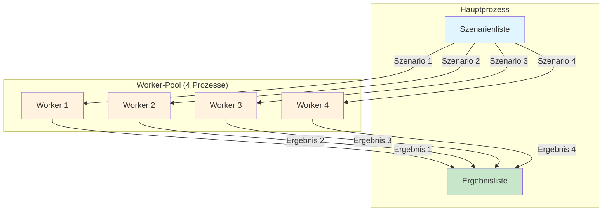

# Beispiel für parallele Simulation

Das Beispiel [examples/05_parallel_two_stage_simulation.py](https://github.com/dgaida/PyADM1ODE/blob/master/examples/05_parallel_two_stage_simulation.py) rechnet viele Simulationen eines Fermenters nebeneinander: einen Vergleich von vier Futtermengen, eine Parameterstudie über einen kinetischen Parameter und eine Monte-Carlo-Analyse. Alle drei nutzen den `ParallelSimulator` aus `pyadm1.simulation.parallel`.

Anders als der Dateiname vermuten lässt, simuliert das Skript einen einzelnen Fermenter (ein `ADM1`-Modell) und keine zweistufige Anlage.

## Übersicht

Das Beispiel zeigt:

- **Basismodell**: ein `ADM1`-Modell mit zwei Substraten, das als Vorlage für jedes Szenario dient  
- **Parallele Szenarien**: vier Futtermengen, simuliert in vier Worker-Prozessen  
- **Parameterstudie (Sweep)**: fünf Werte der maximalen Acetat-Aufnahmerate `k_m_ac`, angegeben als Faktoren der Rate, mit der das Modell rechnet  
- **Monte-Carlo-Analyse**: 50 Zufallsziehungen von `k_m_ac` aus einer Normalverteilung um diese Rate  
- **Zusammenfassende Statistik**: Mittelwert, Standardabweichung, Minimum, Maximum und Median über die Ziehungen  

## Architektur



`run_scenarios` prüft zuerst die Schlüssel jedes Szenarios und startet dann einen Pool aus `n_workers` Prozessen. Das Basismodell selbst wird nicht an die Worker geschickt. Der Simulator schickt stattdessen dessen Konfiguration:

- Flüssigvolumen, Gasvolumen und Temperatur (`V_liq`, `V_gas`, `T_ad`)  
- die Substratparameter des Feedstocks, seine Fütterungsfrequenz und seine `Q`-Konvention  
- die Kalibrierparameter, die am Basismodell gesetzt sind  

Jeder Worker baut aus dieser Konfiguration einen eigenen `Feedstock` und ein eigenes `ADM1`-Modell, wendet das Szenario darauf an, simuliert `duration` Tage und gibt ein `ScenarioResult` zurück. Die Ergebnisse kommen in der Reihenfolge der Szenarienliste zurück.

## Beispiel ausführen

```bash
python examples/05_parallel_two_stage_simulation.py
```

Das Skript braucht keine Argumente, gibt seine Ergebnisse auf der Konsole aus und schreibt keine Dateien.

## Einheiten

- **Futtermengen** sind Tonnen Frischmasse pro Tag [t FM/d] nach der Standardkonvention des `Feedstock` (`simba_q_convention=True`). Das Modell rechnet sie mit der Dichte jedes Substrats in Volumenströme um: 11,4 t FM/d Maissilage sind 10,1 m³/d bei 1129 kg/m³, und 6,1 t FM/d Schweinegülle (1000 kg/m³) sind 6,1 m³/d. Siehe den Abschnitt „Volumetrische ADM1da-Konvention für Q“ in [ADM1-Implementierung](../user_guide/adm1_implementation.md).  
- **Gasströme** (`Q_gas`, `Q_ch4`, `Q_co2`) sind trockenes Gas im Normzustand (0 °C, 1,01325 bar) in Nm³/d. Siehe den Abschnitt „Gemeldete Gasströme“ auf derselben Seite.  

## Code-Durchgang

### 1. Basismodell

```python
duration = 30.0  # days

feedstock = Feedstock(["maize_silage_milk_ripeness", "swine_manure"])
base_feed = [11.4, 6.1]  # t FM/d: maize silage, swine manure

adm1 = ADM1(feedstock, V_liq=1200.0, V_gas=216.0, T_ad=315.15)

initial_state = get_state_zero_from_csv(str(REPO_ROOT / "data" / "initial_states" / "digester_initial8.csv"))

# The workers rebuild the model from the configuration of this base model.
# The feed is not part of it: every scenario brings its own "Q".
parallel = ParallelSimulator(adm1, n_workers=4, verbose=True)
```

- `Feedstock`: Maissilage und Schweinegülle aus der [Substratbibliothek](../substrates/library.md). Ein Fütterungsvektor hat einen Eintrag je Substrat, in der Reihenfolge dieser Liste.  
- `ADM1`: ein Fermenter mit 1200 m³ Flüssigvolumen und 216 m³ Gasvolumen bei 315,15 K (42 °C).  
- `initial_state`: die 41 Zustandsgrößen aus `data/initial_states/digester_initial8.csv`. Jedes Szenario startet aus diesem Zustand.  
- `ParallelSimulator`: vier Worker-Prozesse. Ohne `n_workers` nutzt der Simulator die Zahl der CPU-Kerne minus eins. `verbose=True` gibt die Fortschrittszeilen aus, die unter [Ausgabe](#ausgabe) stehen.  

### 2. Vergleich der Futtermengen

```python
feed_scenarios = [
    ("Low Feed", [8.0, 4.0]),
    ("Base Feed", base_feed),
    ("High Feed", [15.0, 8.0]),
    ("Very High Feed", [20.0, 10.0]),
]
scenarios = [{"Q": Q} for _, Q in feed_scenarios]

results = parallel.run_scenarios(
    scenarios=scenarios,
    duration=duration,
    initial_state=initial_state,
)
```

Ein Szenario ist ein Dictionary. Diese Schlüssel sind erlaubt:

| Schlüssel | Bedeutung |
|-----------|-----------|
| `Q` | Futtermengen je Substrat [t FM/d] |
| `T_ad` | Fermentertemperatur [K]; ersetzt für dieses Szenario die Temperatur des Basismodells |
| `k_dis_PS`, `k_dis_PF`, `k_hyd_ch`, `k_hyd_pr`, `k_hyd_li` | Desintegrations- und Hydrolyseraten |
| `k_m_su`, `k_m_aa`, `k_m_fa`, `k_m_c4`, `k_m_pro`, `k_m_ac`, `k_m_h2` | Maximale Aufnahmeraten |
| `k_p`, `k_L_a`, `K_H_co2`, `K_H_ch4`, `K_H_h2` | Gasauslass, Gas-Flüssig-Transfer und Henry-Konstanten |

Jeder andere Schlüssel, zum Beispiel `k_dis` oder `Y_su`, löst einen `ValueError` aus, bevor eine Simulation startet. Ein falsch geschriebener Name würde sonst ignoriert, und jedes Szenario einer Parameterstudie würde dasselbe Ergebnis liefern.

Szenarien übernehmen keine Fütterung vom Basismodell. Ein Szenario ohne `Q` wird ohne Fütterung simuliert; deshalb übergeben die Parameterstudie und die Monte-Carlo-Analyse weiter unten `Q` als festen Parameter.

Die übrigen Argumente von `run_scenarios`:

- `duration`: simulierte Zeit je Szenario [d], hier 30 Tage  
- `initial_state`: Startzustand jedes Szenarios  
- `compute_metrics`: berechnet aus dem Endzustand die unter [Ergebnisobjekte](#ergebnisobjekte) aufgeführten Werte (Standard `True`)  

### 3. Parameterstudie

Eine Rate, die in einem Szenario steht, ersetzt die Rate des Modells unverändert. Das Modell führt `k_m_ac` mit 8,0 d⁻¹ für 35 °C und korrigiert den Wert auf die Betriebstemperatur; bei den 42 °C dieses Beispiels sind das 11,76 d⁻¹. Auf einen Szenariowert wendet der Simulator keine solche Korrektur an. Das Skript liest deshalb die Rate, mit der das Modell rechnet, und baut die Studie aus Faktoren dieser Rate:

```python
K_M_AC_SWEEP_FACTORS = [0.15, 0.3, 0.5, 1.0, 1.5]
```

```python
k_m_ac_nominal = nominal_rate(adm1, "k_m_ac")
print(f"   k_m_ac of the model at {adm1.T_ad - 273.15:.0f} °C: {k_m_ac_nominal:.2f} 1/d")

sweep_config = ParameterSweepConfig(
    parameter_name="k_m_ac",
    values=[factor * k_m_ac_nominal for factor in K_M_AC_SWEEP_FACTORS],
    other_params={"Q": base_feed},
)

sweep_results = parallel.parameter_sweep(
    config=sweep_config,
    duration=duration,
    initial_state=initial_state,
)
```

`nominal_rate` ist eine kleine Hilfsfunktion des Skripts. Sie liefert einen Kalibrierwert, falls am Basismodell einer gesetzt ist, und sonst die auf die Temperatur des Basismodells korrigierte Rate:

```python
calibration = adm1.get_calibration_parameters()
if name in calibration:
    return float(calibration[name])
rates = ADMParams.apply_temperature_corrections(
    ADMParams.get_kinetic_params(),
    ADMParams.get_temperature_factors(),
    adm1.T_ad,
)
return float(rates[name])
```

`parameter_sweep` erzeugt ein Szenario je Wert: eine Kopie von `other_params` plus den variierten Parameter. Weitere Schlüsselwortargumente werden an `run_scenarios` weitergereicht. Das Skript gibt danach eine Zeile je erfolgreichem Szenario aus und nennt das Szenario mit dem höchsten Methanstrom.

### 4. Monte-Carlo-Analyse

```python
K_M_AC_REL_STD = 0.10
```

```python
mc_config = MonteCarloConfig(
    n_samples=50,
    parameter_distributions={"k_m_ac": (k_m_ac_nominal, K_M_AC_REL_STD * k_m_ac_nominal)},
    fixed_params={"Q": base_feed},
    seed=42,
)

mc_results = parallel.monte_carlo(
    config=mc_config,
    duration=duration,
    initial_state=initial_state,
)
summary = parallel.summarize_results(mc_results)
```

- `parameter_distributions`: Mittelwert und Standardabweichung einer Normalverteilung je Parameter, hier die Rate des Modells und 10 % davon. Andere Verteilungen gibt es nicht, und die Ziehungen werden nicht abgeschnitten; Mittelwert und Standardabweichung sind daher so zu wählen, dass die Werte physikalisch sinnvoll bleiben.  
- `fixed_params`: Schlüssel, die in jeder Stichprobe gleich sind  
- `seed`: setzt den Startwert des Zufallsgenerators von NumPy, sodass jeder Lauf dieselben 50 Werte zieht  
- `summarize_results`: liefert `n_scenarios`, `n_successful`, `n_failed` und `success_rate` sowie unter `metrics` für jede Metrik die Statistiken `mean`, `std`, `min`, `max`, `median`, `q25` und `q75` über die erfolgreichen Szenarien. `std` ist die Standardabweichung der Grundgesamtheit (`np.std`).  

## Ergebnisobjekte

Jedes Szenario liefert ein `ScenarioResult`:

| Feld | Inhalt |
|------|--------|
| `scenario_id` | Position in der Szenarienliste, beginnend bei 0 |
| `parameters` | Das Szenario-Dictionary |
| `success` | `True`, wenn die Simulation durchgelaufen ist |
| `duration` | Simulierte Zeit [d] |
| `final_state` | Zustandsvektor am Ende (41 Werte) |
| `time_series` | Nur mit `save_time_series=True`: die letzten zehn Werte von `Q_gas`, `Q_ch4` und `pH` (pH auf eine Nachkommastelle gerundet), gespeichert einmal je `dt`-Schritt |
| `metrics` | Aus dem Endzustand berechnete Werte, siehe unten |
| `error` | Ausnahmetyp, Meldung und Traceback eines fehlgeschlagenen Szenarios |
| `execution_time` | Laufzeit des Szenarios in seinem Worker [s] |

`metrics` enthält diese Werte:

| Schlüssel | Einheit | Bedeutung |
|-----------|---------|-----------|
| `Q_gas` | Nm³/d | Trockenes Biogas |
| `Q_ch4` | Nm³/d | Methan |
| `Q_co2` | Nm³/d | Kohlendioxid |
| `p_gas` | bar | Summe der trockenen Partialdrücke von Wasserstoff, Methan und Kohlendioxid |
| `CH4_content` | - | `Q_ch4 / Q_gas`, der Methananteil des trockenen Gases |
| `pH` | - | pH-Wert aus der Ladungsbilanz |
| `Q_total` | t FM/d | Summe der Futtermengen des Szenarios wie eingegeben |
| `specific_gas_production` | Nm³/t FM | `Q_gas / Q_total` |
| `specific_ch4_production` | Nm³/t FM | `Q_ch4 / Q_total` |
| `HRT` | d | `V_liq` geteilt durch den Volumenstrom, mit dem das Modell für diese Fütterung rechnet |

Die Einheiten von `Q_total` und der spezifischen Erträge gelten für die Standardkonvention des `Feedstock`. VFA, TAC und FOS/TAC sind in den Metriken nicht enthalten.

## Ausgabe

Die folgenden Blöcke sind die Ausgabe eines Laufs; `...` markiert ausgelassene Zeilen. Die Zeilen mit `Total time` stammen aus diesem Lauf auf einem PC und unterscheiden sich von Rechner zu Rechner und von Lauf zu Lauf. Die simulierten Werte wiederholen sich von Lauf zu Lauf, weil die Monte-Carlo-Ziehungen durch `seed=42` festgelegt sind.

### Vergleich der Futtermengen

```text
======================================================================
PyADM1 Parallel Simulation Example
======================================================================

1. Building base ADM1 model...  

2. Running feed-rate comparison...  
Starting parallel simulation with 4 scenarios
Using 4 worker processes
  Completed 4/4 scenarios

Simulation complete:
  Total scenarios: 4
  Successful: 4
  Failed: 0
  Total time: 3.6 seconds
  Average time per scenario: 0.90 seconds

   Feed-rate results (feed in t FM/d, gas flows in Nm³/d, HRT in d):
   ------------------------------------------------------------------
   Scenario           Feed     Q_gas     Q_ch4   CH4 %     pH     HRT
   Low Feed           12.0    1396.8     739.3    52.9   7.44   108.3
   Base Feed          17.5    1893.0    1003.7    53.0   7.44    74.1
   High Feed          23.0    2393.3    1270.0    53.1   7.43    56.4
   Very High Feed     30.0    3053.0    1620.1    53.1   7.42    43.3
```

- Der Gasstrom steigt mit der Fütterung, aber unterproportional: Die 2,5-fache Fütterung (12,0 auf 30,0 t FM/d) ergibt das 2,19-fache Gas, und das Gas je Tonne Frischmasse (`Q_gas / Q_total`) sinkt von 116,4 auf 101,8 Nm³.  
- Der Methangehalt des trockenen Gases bleibt in allen vier Szenarien bei etwa 53 %, und der pH-Wert ändert sich nur von 7,44 auf 7,42.  
- Die Verweilzeit ist länger als `V_liq` geteilt durch die Fütterung in Tonnen, weil die Silage weniger als 1 m³ je Tonne einnimmt: Die Base-Feed-Fütterung von 17,5 t FM/d ist ein Volumenstrom von 16,2 m³/d, das ergibt 74,1 d.  
- Die Werte beschreiben Tag 30, keinen stationären Zustand. Alle Szenarien starten aus demselben Anfangszustand, und 30 Tage sind kürzer als jede Verweilzeit in der Tabelle.  

### Parameterstudie

```text
3. Parameter sweep over k_m_ac...  
   k_m_ac of the model at 42 °C: 11.76 1/d
Parameter sweep: k_m_ac
  Values: [1.7635371857293733, 3.5270743714587467, 5.878457285764578, 11.756914571529157, 17.635371857293734]
Starting parallel simulation with 5 scenarios
Using 4 worker processes
  Completed 5/5 scenarios

Simulation complete:
  Total scenarios: 5
  Successful: 5
  Failed: 0
  Total time: 2.6 seconds
  Average time per scenario: 0.51 seconds

   Sweep results (k_m_ac in 1/d, gas flows in Nm³/d):
   ------------------------------------------------------------------
   Factor   k_m_ac     Q_gas     Q_ch4   CH4 %     pH
     0.15     1.76    1009.4       9.1     0.9   4.50
     0.30     3.53    1855.3     968.7    52.2   7.13
     0.50     5.88    1873.4     985.2    52.6   7.36
     1.00    11.76    1893.0    1003.7    53.0   7.44
     1.50    17.64    1894.3    1005.0    53.1   7.44

   Highest methane flow: 1005.0 Nm³/d at k_m_ac = 17.64 1/d (factor 1.50)
```

- Bei Faktor 0,15 (1,76 d⁻¹) ist der Fermenter nach 30 Tagen versauert: Der pH-Wert liegt bei 4,50, und Methan macht nur 9,1 der 1009,4 Nm³/d Gas aus (0,9 %).  
- Von Faktor 0,30 bis Faktor 1,00 steigt der Methanstrom um 3,6 %, von 968,7 auf 1003,7 Nm³/d, und der pH-Wert von 7,13 auf 7,44.  
- Faktor 1,00 ist die Rate des Modells; seine Zeile entspricht deshalb der Zeile Base Feed im Vergleich der Futtermengen.  
- Oberhalb der Rate des Modells ändert sich wenig: Faktor 1,50 bringt 1,3 Nm³/d mehr. Der höchste Methanstrom ist deshalb das obere Ende der Studie und kein Optimum in ihrem Inneren.  

### Monte-Carlo-Analyse

```text
4. Monte Carlo uncertainty (50 samples)...  
Monte Carlo simulation:
  Samples: 50
  Parameters with uncertainty:
    k_m_ac: N(11.756914571529157, 1.1756914571529158²)
Starting parallel simulation with 50 scenarios
Using 4 worker processes
  Completed 10/50 scenarios
...
  Completed 50/50 scenarios

Simulation complete:
  Total scenarios: 50
  Successful: 50
  Failed: 0
  Total time: 5.0 seconds
  Average time per scenario: 0.10 seconds

   Success rate: 100.0%
   k_m_ac draws [1/d]: 9.45 to 13.93

   Methane production [Nm³/d]:
     mean ± std : 1003.4 ± 0.7
     min  / max : 1001.7 / 1004.4
     median     : 1003.6

======================================================================
Parallel demonstration completed successfully!
======================================================================
```

- Die 50 Ziehungen von `k_m_ac` liegen zwischen 9,45 und 13,93 d⁻¹. Alle 50 Szenarien sind durchgelaufen.  
- Der Methanstrom beträgt 1003,4 ± 0,7 Nm³/d und liegt zwischen 1001,7 und 1004,4 Nm³/d.  
- Die Standardabweichung des Parameters beträgt 10 % seines Mittelwerts, die des Methanstroms 0,07 % (0,7 / 1003,4). Um die Rate des Modells herum reagiert der Methanstrom nach 30 Tagen nur schwach auf `k_m_ac`; das passt zum flachen oberen Teil der Parameterstudie.  
- Das Skript gibt nur die Statistik von `Q_ch4` aus. `summary["metrics"]` enthält dieselben Statistiken und die Quartile `q25` und `q75` für jede Metrik.  

## Beispiel anpassen

- **Andere Parameter**: Jeder Schlüssel der Tabelle in [Schritt 2](#2-vergleich-der-futtermengen) lässt sich in einem Szenario, als `parameter_name` einer Parameterstudie oder in `parameter_distributions` verwenden. `nominal_rate` liefert die Rate des Modells für die Schlüssel `k_dis_*`, `k_hyd_*` und `k_m_*`.  
- **Temperatur**: `T_ad` in Kelvin in ein Szenario aufnehmen, zum Beispiel `{"Q": base_feed, "T_ad": 311.15}`. Alle Szenarien eines Aufrufs können unterschiedliche Temperaturen haben.  
- **Zeitreihen**: `save_time_series=True` und eine Schrittweite `dt` in Tagen an `run_scenarios`, `parameter_sweep` oder `monte_carlo` übergeben. Jedes Ergebnis enthält dann die letzten zehn gespeicherten Werte von `Q_gas`, `Q_ch4` und `pH`. Ohne `save_time_series=True` hat `dt` keine Wirkung.  
- **Kalibriertes Basismodell**: Parameter, die mit `adm1.set_calibration_parameters({...})` am Basismodell gesetzt sind, gelten für jedes Szenario. Ein Szenariowert für denselben Parameter hat Vorrang.  
- **Substrate und Fermentergröße**: die Substratliste des `Feedstock` und die Argumente von `ADM1` ändern. Die Fütterungsvektoren folgen der Reihenfolge der Substratliste.  
- **Zahl der Worker**: `n_workers` setzen. Jeder Aufruf von `run_scenarios` startet einen eigenen Pool. Mit `n_workers=1` oder einem einzelnen Szenario rechnet der Simulator im Hauptprozess und startet keinen Pool.  
- **Fehlgeschlagene Szenarien**: Ein Szenario, das eine Ausnahme auslöst, hält die anderen nicht auf. Sein Ergebnis hat `success=False` und den Grund in `error`.  

Mehrere Parameter lassen sich mit `multi_parameter_sweep` gleichzeitig variieren; das Skript nutzt diese Methode nicht. Sie simuliert jede Kombination der angegebenen Werte:

```python
results = parallel.multi_parameter_sweep(
    parameter_configs={"k_m_ac": [3.5, 8.0], "T_ad": [311.15, 315.15]},
    duration=duration,
    initial_state=initial_state,
    fixed_params={"Q": base_feed},
)
```

Das ergibt 2 × 2 = 4 Szenarien. In der Ergebnisliste ändert sich der letzte Parameter am schnellsten: `(3.5, 311.15)`, `(3.5, 315.15)`, `(8.0, 311.15)`, `(8.0, 315.15)`.

In eigenen Skripten gehört der Aufruf wie im Beispiel in eine Funktion `main()` hinter `if __name__ == "__main__":`. Die Worker werden mit der Methode `spawn` gestartet (unter Linux mit `forkserver`), die das Hauptmodul in jedem Worker erneut importiert; siehe die Python-Dokumentation zu [multiprocessing](https://docs.python.org/3/library/multiprocessing.html). Die Umgebungsvariable `PYADM1_MP_START_METHOD` wählt eine andere Startmethode.

## Ähnliche Beispiele

- [`basic_digester.md`](basic_digester.md): Grundlagen der Fermentersimulation  
- [`two_stage_plant.md`](two_stage_plant.md): Konfiguration zweistufiger Anlagen  
- [examples/06_parallel_operation_studies.py](https://github.com/dgaida/PyADM1ODE/blob/master/examples/06_parallel_operation_studies.py): Drei größere Studien mit demselben Simulator und drei Substraten (Maissilage, Rindergülle, Grassilage): ein Raster aus 54 Fütterungsszenarien über Verweilzeit und Raumbelastung, 66 Substratmischungen bei konstanter Gesamtfütterung und zehn Temperaturen über den Szenario-Schlüssel `T_ad`. Das Skript speichert je Studie eine Abbildung in `output/`.  
- [Simulation-API](../api/simulation.md): Referenz zu `ParallelSimulator`, `ScenarioResult`, `ParameterSweepConfig` und `MonteCarloConfig`  

## Zusammenfassung

1. **Ein Basismodell, viele Szenarien**: Der `ParallelSimulator` schickt die Konfiguration des Basismodells an Worker-Prozesse, und jedes Szenario ändert darauf die Fütterung, die Temperatur oder Kalibrierparameter.  
2. **Drei Wege zu Szenarien**: eine ausdrückliche Liste (`run_scenarios`), ein Parameter über mehrere Werte (`parameter_sweep`) und Zufallsziehungen aus Normalverteilungen (`monte_carlo`).  
3. **Ergebnisse als Zahlen**: Jedes Szenario liefert seinen Endzustand und Metriken wie trockene Gasströme in Nm³/d, Methangehalt und pH-Wert; `summarize_results` verdichtet sie zu Statistiken.  
