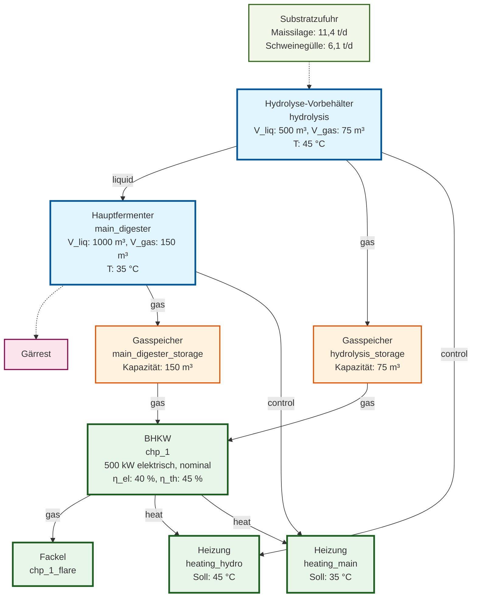

# Zweistufige Biogasanlage Beispiel

[](https://colab.research.google.com/github/dgaida/PyADM1ODE/blob/master/examples/colab_02_complex_plant.ipynb)

Das Beispiel [examples/02_two_stage_plant.py](https://github.com/dgaida/PyADM1ODE/blob/master/examples/02_two_stage_plant.py)
baut eine zweistufige Biogasanlage auf: einen Hydrolyse-Vorbehälter und einen
Hauptfermenter in Reihe, ein BHKW mit Fackel und je Stufe ein Heizsystem. Es
simuliert zehn Tage und gibt den Endzustand beider Behälter aus.

Das Colab-Notebook baut dieselbe Anlage mit anderen Komponenten-IDs und einem
kürzeren Lauf (5 Tage in Tagesschritten) auf; seine Zahlen weichen deshalb von
denen auf dieser Seite ab.

## Übersicht

Das Beispiel zeigt:

- Zwei ADM1-Fermenter in Reihe, verbunden über eine Flüssigkeitsverbindung  
- Den Gasspeicher, den `add_digester` für jeden Fermenter anlegt  
- Ein BHKW, das aus beiden Gasspeichern versorgt wird, mit seiner automatisch angelegten Fackel  
- Je Stufe ein Heizsystem, das an seinen Fermenter gekoppelt ist und Wärme vom BHKW erhält  
- Das Speichern der Anlage in eine JSON-Datei  

## Systemarchitektur



Das Diagramm zeigt die acht Komponenten und zehn Verbindungen, die die
Anlagenzusammenfassung in der Ausgabe unten auflistet; die Beschriftungen der
Pfeile sind die Verbindungstypen. Eine `control`-Verbindung gibt Temperatur und
Zufuhr eines Fermenters an sein Heizsystem weiter. Die gestrichelten Pfeile
sind keine Verbindungen: Die Substratzufuhr wird als `Q_substrates` am
Vorbehälter gesetzt, und der Gärrest ist der Ablauf des Hauptfermenters. Die
Fackel ist hinter dem BHKW angeschlossen; sie verbrennt das Gas, das die
Gasspeicher abblasen.

## Anlagenkonfiguration

### Fermenter

| Eigenschaft            | Hydrolyse-Vorbehälter                      | Hauptfermenter                |
|------------------------|--------------------------------------------|-------------------------------|
| Komponenten-ID         | `hydrolysis`                               | `main_digester`               |
| Flüssigvolumen `V_liq` | 500 m³                                     | 1000 m³                       |
| Gasraum `V_gas`        | 75 m³                                      | 150 m³                        |
| Temperatur `T_ad`      | 318,15 K (45 °C)                           | 308,15 K (35 °C)              |
| Substratzufuhr         | 11,4 t/d Maissilage, 6,1 t/d Schweinegülle | Keine                         |
| Zulauf                 | 16,2 m³/d Substrat                         | 16,2 m³/d aus dem Vorbehälter |
| Verweilzeit            | 30,9 d                                     | 61,7 d                        |

Die Fütterungsmengen sind Tonnen Frischmasse pro Tag, zusammen 17,5 t/d. Der
Feedstock rechnet sie mit der Dichte jedes Substrats in einen Volumenstrom um:
11,4 t/d Maissilage bei 1129 kg/m³ sind 10,1 m³/d, und Schweinegülle zählt mit
1000 kg/m³. Zusammen ergibt das 16,2 m³/d (siehe
[Volumetrische ADM1da-Konvention für Q](../user_guide/adm1_implementation.md#volumetrische-adm1da-konvention-fur-q)).
Die Verweilzeit ist das Flüssigvolumen geteilt durch diesen Strom. Das Skript
entnimmt den Strom aus `feedstock.actual_Q` und gibt die gerundeten
Verweilzeiten, 31 d und 62 d, in seinem Startbanner aus.

### Gas- und Energiekomponenten

| Komponente                  | ID                      | Angelegt durch | Einstellungen                                                           |
|-----------------------------|-------------------------|----------------|-------------------------------------------------------------------------|
| Gasspeicher, Vorbehälter    | `hydrolysis_storage`    | `add_digester` | Membranspeicher, Kapazität 75 m³                                        |
| Gasspeicher, Hauptfermenter | `main_digester_storage` | `add_digester` | Membranspeicher, Kapazität 150 m³                                       |
| BHKW                        | `chp_1`                 | `add_chp`      | 500 kW elektrisch (nominal), `eta_el=0.40`, `eta_th=0.45`               |
| Fackel                      | `chp_1_flare`           | `add_chp`      | Zerstörungsgrad 0,98                                                    |
| Heizung, Vorbehälter        | `heating_hydro`         | `add_heating`  | Soll 318,15 K, gekoppelt an `hydrolysis`, Wärmeverlust 0,5 kW/K         |
| Heizung, Hauptfermenter     | `heating_main`          | `add_heating`  | Soll 308,15 K, gekoppelt an `main_digester`, Wärmeverlust 0,5 kW/K      |

Ein Fermenter speichert selbst kein Gas: `V_gas` ist der Gasraum der
ADM1-Gasphase, und das Gas, das ihn verlässt, geht in die getrennte
`GasStorage`-Komponente `<digester_id>_storage`. Die Kapazität dieses Speichers
ist `V_gas`, mindestens aber 50 m³. Der Zerstörungsgrad der Fackel und der
Wärmeverlustkoeffizient von 0,5 kW/K sind Standardwerte des Pakets; das Skript
setzt sie nicht.

## Code-Durchgang

Die Auszüge stammen aus dem Skript; die meisten `print`-Aufrufe sind
weggelassen.

### 1. Feedstock und Fütterungsmengen

```python
feedstock = Feedstock(["maize_silage_milk_ripeness", "swine_manure"])

# Substrate feed in t FM/d, one slot per substrate of the feedstock:
# hydrolysis stage gets fresh substrate, main stage inherits.
hydro_feed = [11.4, 6.1, 0, 0, 0, 0, 0, 0, 0, 0]
main_feed = [0.0] * 10

# The model works with the volume flow of the feed [m³/d]: the feedstock
# converts the mass flows with the density of each substrate.
q_feed = sum(feedstock.actual_Q(hydro_feed))
```

- Die Reihenfolge der Substrat-IDs legt die Plätze der Fütterungslisten fest: Platz 0 ist Maissilage (Milchreife), Platz 1 ist Schweinegülle, die übrigen Plätze bleiben null. Die mitgelieferten Substrate stehen unter [Beispiel-Substrate](../substrates/library.md).  
- Die Fütterungsmengen sind Tonnen Frischmasse pro Tag.  
- `main_feed` enthält nur Nullen: Der Hauptfermenter erhält kein eigenes Substrat, nur den Ablauf des Vorbehälters.  
- `feedstock.actual_Q` gibt den Volumenstrom jedes Substrats zurück. Ihre Summe `q_feed` sind die 16,2 m³/d, mit denen das Modell rechnet.  

### 2. Zwei Fermenter

```python
plant = BiogasPlant("Two-Stage Plant (ADM1 / SIMBA# biogas)")
cfg = PlantConfigurator(plant, feedstock)

# Hydrolysis pre-tank — 45 °C, between the mesophilic and the thermophilic range
hydro_digester, _ = cfg.add_digester(
    digester_id="hydrolysis",
    V_liq=500.0,
    V_gas=75.0,
    T_ad=318.15,
    name="Hydrolysis Pre-Tank",
    Q_substrates=hydro_feed,
)
hrt_hydro = hydro_digester.V_liq / q_feed

# Main methanogenesis fermenter — larger volume, mesophilic.
# Its inflow is the effluent of the pre-tank, which has the same volume flow.
main_digester, _ = cfg.add_digester(
    digester_id="main_digester",
    V_liq=1000.0,
    V_gas=150.0,
    T_ad=308.15,
    name="Main Fermenter",
    Q_substrates=main_feed,
)
hrt_main = main_digester.V_liq / q_feed
```

- Beide Stufen nutzen dieselbe Klasse `Digester`. Ein eigenes Hydrolysemodell gibt es nicht; Volumen, Temperatur und Zufuhr bestimmen, was in einem Behälter abläuft.  
- Eine Datei mit Anfangszustand ist nicht nötig: `add_digester` leitet den Anfangszustand jedes Behälters aus dem Feedstock und den Fütterungsmengen ab.  
- Jeder Aufruf legt außerdem den Gasspeicher `<digester_id>_storage` an und verbindet den Fermenter mit ihm.  
- `add_digester` gibt den Fermenter zurück. Das Skript teilt dessen Flüssigvolumen durch `q_feed` und erhält so die Verweilzeit für das Startbanner.  

### 3. BHKW, Fackel und Heizung

```python
# CHP + heating. digester_id ties each heating system to its digester, so
# its heat demand covers the heat loss of the tank and warming the feed.
cfg.add_chp(chp_id="chp_1", P_el_nom=500.0, eta_el=0.40, eta_th=0.45)
cfg.add_heating(
    heating_id="heating_hydro",
    target_temperature=318.15,
    name="Hydrolysis Heating",
    digester_id="hydrolysis",
)
cfg.add_heating(
    heating_id="heating_main",
    target_temperature=308.15,
    name="Main Stage Heating",
    digester_id="main_digester",
)
```

- `add_chp` legt außerdem die Fackel `chp_1_flare` an und schließt sie hinter dem BHKW an.  
- `digester_id` legt eine `control`-Verbindung vom Fermenter zum Heizsystem an. Das Heizsystem erhält dann Temperatur und Substratzufuhr des Fermenters, und sein Wärmebedarf ist der Wärmeverlust plus die Wärme zum Aufheizen der Zufuhr.  
- Die Fermenter definieren keine k-Werte, deshalb gilt für den Wärmeverlust der Standardkoeffizient: 0,5 kW/K × (Fermentertemperatur − Außentemperatur).  
- `target_temperature` eines Heizsystems ist nicht mit `T_ad` des Fermenters gekoppelt; das Skript setzt beide auf denselben Wert.  

### 4. Verbindungen

```python
cfg.connect("hydrolysis", "main_digester", "liquid")
cfg.auto_connect_digester_to_chp("hydrolysis", "chp_1")
cfg.auto_connect_digester_to_chp("main_digester", "chp_1")
cfg.auto_connect_chp_to_heating("chp_1", "heating_hydro")
cfg.auto_connect_chp_to_heating("chp_1", "heating_main")

plant.initialize()
print(plant.get_summary())
```

- Die Flüssigkeitsverbindung gibt den Ablauf des Vorbehälters, Menge und Zusammensetzung, an den Hauptfermenter weiter.  
- `auto_connect_digester_to_chp` verbindet den Gasspeicher des Fermenters mit dem BHKW, nicht den Fermenter selbst.  
- `auto_connect_chp_to_heating` legt eine Wärmeverbindung an. Die Wärme des BHKW wird gleichmäßig auf die angeschlossenen Heizsysteme aufgeteilt.  

### 5. Simulation

```python
duration = 10.0
dt = 1.0 / 24.0
results = plant.simulate(duration=duration, dt=dt, save_interval=1.0)
```

Der Lauf umfasst 240 Schritte von einer Stunde. `results` enthält elf Einträge:
einen nach dem ersten Schritt und einen je vollem Tag. Jeder Eintrag hat die
Schlüssel `time` und `components`; `components` ordnet jeder Komponenten-ID die
Ausgaben dieser Komponente zu.

### 6. Endzustand und JSON-Export

```python
final = results[-1]
h = final["components"]["hydrolysis"]
m = final["components"]["main_digester"]

total_gas = h["Q_gas"] + m["Q_gas"]
total_ch4 = h["Q_ch4"] + m["Q_ch4"]
```

Das Skript gibt `Q_gas`, `Q_ch4`, `pH`, `VFA` und `TAC` beider Fermenter und
die Summen der beiden Gasströme aus. Danach speichert es die Anlage:

```python
output_path = REPO_ROOT / "output"
output_path.mkdir(exist_ok=True)
plant.to_json(str(output_path / "two_stage_plant_config.json"))
```

`BiogasPlant.from_json(path, feedstock)` baut die Anlage aus dieser Datei
wieder auf. Der Feedstock muss erneut übergeben werden, weil die Datei ihn
nicht enthält.

## Gasführung in einem Anlagenschritt

`plant.simulate` ruft `BiogasPlant.step()` einmal je Zeitschritt auf. Ein
Schritt rechnet jede Komponente einmal, in dieser Reihenfolge:

1. Die Fermenter: zuerst der Vorbehälter, dann der Hauptfermenter mit dem Ablauf, den der Vorbehälter im selben Schritt erzeugt hat.  
2. Die Gasspeicher: Jeder Speicher nimmt das Gas auf, das sein Fermenter in diesem Schritt erzeugt hat, versorgt das BHKW und bläst erst danach an die Fackel ab, was über seiner Kapazität liegt.  
3. Das BHKW mit dem Gas, das die Speicher geliefert haben, danach die Heizsysteme mit der Wärme des BHKW.  
4. Die Fackel mit dem Gas, das die Speicher abgeblasen haben.  

Das BHKW fordert das Gas an, das es bei Volllast braucht, und verteilt diesen
Bedarf gleichmäßig auf die beiden Speicher. Weil Versorgung und Abblasen im
selben Schritt abgerechnet werden, hängt die abgeblasene Menge nicht von der
Schrittweite ab. Siehe
[Gasbilanz in einer Anlage](../user_guide/components/energy.md#gasbilanz-in-einer-anlage).

## Ausgabe

Das Skript wird aus dem Wurzelverzeichnis des Repositorys gestartet:

```bash
python examples/02_two_stage_plant.py
```

Es gibt Folgendes aus; nur der absolute Pfad in der letzten Zeile ist zu `...`
gekürzt:

```text
======================================================================
PyADM1 Two-Stage Plant Example
======================================================================

Building plant components...
  - Hydrolysis pre-tank: 500 m³ liquid @ 45 °C (HRT about 31 d)  
  - Main fermenter:   1000 m³ liquid @ 35 °C (HRT about 62 d)  
  - CHP: 500 kW_el, eta_el=40%, eta_th=45%  

Connecting components...
=== Two-Stage Plant (ADM1 / SIMBA# biogas) ===
Simulation time: 0.00 days

Components (8):
  - Hydrolysis Pre-Tank (digester)  
  - Hydrolysis Pre-Tank Gas Storage (storage)  
  - Main Fermenter (digester)  
  - Main Fermenter Gas Storage (storage)  
  - chp_1 (chp)  
  - chp_1_flare (flare)  
  - Hydrolysis Heating (heating)  
  - Main Stage Heating (heating)  

Connections (10):
  - Hydrolysis Pre-Tank -> Hydrolysis Pre-Tank Gas Storage (gas)  
  - Main Fermenter -> Main Fermenter Gas Storage (gas)  
  - chp_1 -> chp_1_flare (gas)  
  - Hydrolysis Pre-Tank -> Hydrolysis Heating (control)  
  - Main Fermenter -> Main Stage Heating (control)  
  - Hydrolysis Pre-Tank -> Main Fermenter (liquid)  
  - Hydrolysis Pre-Tank Gas Storage -> chp_1 (gas)  
  - Main Fermenter Gas Storage -> chp_1 (gas)  
  - chp_1 -> Hydrolysis Heating (heat)  
  - chp_1 -> Main Stage Heating (heat)  

Simulating 10 days at dt=1.0 h...
Simulated 100/240 steps
Simulated 200/240 steps

======================================================================
Final state (day 10.0):
======================================================================

Hydrolysis pre-tank:
  Biogas:      1679.0 Nm³/d
  Methane:      891.1 Nm³/d
  pH:            7.42
  VFA:           0.24 g HAc-eq/L
  TAC:           5.73 g CaCO3/L

Main fermenter:
  Biogas:       216.6 Nm³/d
  Methane:      114.0 Nm³/d
  pH:            7.39
  VFA:           0.03 g HAc-eq/L
  TAC:           6.30 g CaCO3/L

Plant total:
  Biogas:      1895.6 Nm³/d
  Methane:     1005.1 Nm³/d
  CH4 frac.:     53.0 %
Plant configuration saved to .../output/two_stage_plant_config.json
```

## Interpretation

### Endzustand an Tag 10

| Größe                            | Hydrolyse-Vorbehälter | Hauptfermenter | Anlage |
|----------------------------------|-----------------------|----------------|--------|
| Biogas, trocken [Nm³/d]          | 1679,0                | 216,6          | 1895,6 |
| Methan [Nm³/d]                   | 891,1                 | 114,0          | 1005,1 |
| Methangehalt des trockenen Gases | 53,1 %                | 52,6 %         | 53,0 % |
| Anteil am Methan der Anlage      | 88,7 %                | 11,3 %         | 100 %  |
| pH                               | 7,42                  | 7,39           | –      |
| VFA [g HAc-eq/L]                 | 0,24                  | 0,03           | –      |
| TAC [g CaCO3/L]                  | 5,73                  | 6,30           | –      |
| VFA/TAC                          | 0,04                  | 0,005          | –      |

**Die Gasströme sind trockenes Gas im Normzustand.** `Q_gas` und `Q_ch4` sind
in Nm³/d (0 °C, 1,01325 bar) angegeben und enthalten keinen Wasserdampf. Der
Methangehalt von 53,0 % ist deshalb der des trockenen Gases, wie ihn ein
Gasanalysator anzeigt. Siehe
[Gemeldete Gasströme](../user_guide/adm1_implementation.md#gemeldete-gasstrome).

**Der Vorbehälter erzeugt den größten Teil des Gases.** 891,1 der 1005,1 Nm³/d
Methan (88,7 %) stammen aus dem ersten Behälter. Mit einer Verweilzeit von
30,9 d, einem pH von 7,42 und 0,24 g HAc-eq/L VFA läuft in ihm die vollständige
Abbaukette bis zum Methan ab. In dieser Konfiguration ist er keine getrennte
Versäuerungsstufe. Der Hauptfermenter vergärt den Rest und liefert weitere
114,0 Nm³/d Methan.

**Säuren und Pufferkapazität.** Die VFA liegen bei 0,24 und 0,03 g HAc-eq/L bei
einem TAC von 5,73 und 6,30 g CaCO3/L; das ergibt VFA/TAC-Verhältnisse von 0,04
und 0,005. Der pH liegt bei 7,42 und 7,39. Typische Bereiche dieser Kenngrößen
stehen unter
[Optimale Betriebsbereiche](../user_guide/components/biological.md#optimale-betriebsbereiche).

**Ertrag je Tonne Zufuhr.** Die 17,5 t/d Frischmasse ergeben je Tonne 108 Nm³
Biogas und 57 Nm³ Methan an Tag 10.

### Weitere Ergebnisse

`main()` gibt die Anlage und die Ergebnisliste zurück. Daraus lassen sich die
Ausgaben der übrigen Komponenten lesen, zum Beispiel:

```python
plant, results = main()
final = results[-1]["components"]

chp = final["chp_1"]
print(f"CHP electrical power:  {chp['P_el']:6.1f} kW")
print(f"CHP thermal power:     {chp['P_th']:6.1f} kW")
print(f"CHP gas consumption:   {chp['Q_gas_consumed']:6.1f} Nm³/d")

for storage_id in ("hydrolysis_storage", "main_digester_storage"):
    storage = final[storage_id]
    print(f"{storage_id}: {storage['stored_volume_m3']:.1f} m³ stored, {storage['cumulative_vented_m3']:.1f} m³ vented")
print(f"chp_1_flare: {final['chp_1_flare']['cumulative_vented_m3']:.1f} m³ burnt")

for heating_id in ("heating_hydro", "heating_main"):
    heating = final[heating_id]
    print(f"{heating_id}: {heating['Q_heat_supplied']:.1f} kW supplied, {heating['P_aux_heat']:.1f} kW auxiliary heat")

balance = plant.get_electricity_balance()
print(f"Net electrical power:  {balance['P_el_net']:6.1f} kW")
```

```text
CHP electrical power:   167.5 kW
CHP thermal power:      188.4 kW
CHP gas consumption:   1895.6 Nm³/d
hydrolysis_storage: 0.0 m³ stored, 0.0 m³ vented
main_digester_storage: 0.0 m³ stored, 0.0 m³ vented
chp_1_flare: 0.0 m³ burnt
heating_hydro: 37.6 kW supplied, 0.0 kW auxiliary heat
heating_main: 10.0 kW supplied, 0.0 kW auxiliary heat
Net electrical power:   162.5 kW
```

**Das BHKW läuft mit einem Drittel seiner Nennleistung.** 1005,1 Nm³/d Methan
mit 10 kWh/Nm³ sind 418,8 kW Brennstoffleistung. Mit dem elektrischen
Wirkungsgrad von 0,40 ergibt das 167,5 kW, 33,5 % der nominalen 500 kW. Die
thermische Leistung ist 167,5 kW × 0,45 / 0,40 = 188,4 kW. Bei Volllast
bräuchte das BHKW 3000 Nm³/d Methan, etwa das Dreifache der Produktion.

**Die Speicher bleiben leer, und die Fackel wird nicht genutzt.** Das BHKW kann
mehr Gas verbrennen, als die Fermenter erzeugen, und nimmt deshalb das gesamte
Gas jedes Schritts ab: Sein Verbrauch von 1895,6 Nm³/d entspricht der
Produktion. Beide Speicher sind am Ende des Schritts leer, und nichts wird
abgeblasen.

**Der Wärmebedarf ist Wärmeverlust plus Aufheizen der Zufuhr.** Der Vorbehälter
braucht 37,6 kW: 0,5 kW/K × (45 °C − 15 °C) = 15,0 kW Wärmeverlust und 22,6 kW
für das Aufheizen der 17,5 t/d Zufuhr auf 45 °C. Die Substrate kommen mit ihrer
Lagertemperatur an, 9,3 °C bei der Maissilage und 20 °C bei der Schweinegülle.
Der Hauptfermenter braucht 0,5 kW/K × (35 °C − 15 °C) = 10,0 kW. Er hat keine
Substratzufuhr, und der Zulauf aus dem Vorbehälter geht nicht in die
Wärmebilanz ein. 15 °C ist die Standard-Außentemperatur von `BiogasPlant`. Die
188,4 kW BHKW-Wärme decken die 47,6 kW, Zusatzwärme ist also nicht nötig.

**Nettoleistung.** Das BHKW verbraucht 3 % seiner Leistung für die eigenen
Nebenaggregate (Standardwert des Pakets). Weitere Stromverbraucher hat die
Anlage nicht; es bleiben 162,5 kW.

Der Verlauf über die zehn Tage zeigt, wie weit die Anlage von einem stationären
Zustand entfernt ist:

```python
print("  day  pre-tank     main  CH4 %  CHP kW")
for r in results:
    c = r["components"]
    q_gas = c["hydrolysis"]["Q_gas"] + c["main_digester"]["Q_gas"]
    q_ch4 = c["hydrolysis"]["Q_ch4"] + c["main_digester"]["Q_ch4"]
    print(
        f"{r['time']:5.2f} {c['hydrolysis']['Q_gas']:9.1f} {c['main_digester']['Q_gas']:8.1f}"
        f" {100 * q_ch4 / q_gas:6.1f} {c['chp_1']['P_el']:7.1f}"
    )
```

```text
  day  pre-tank     main  CH4 %  CHP kW
 0.04    1814.4   1646.7   22.1   181.6
 1.00    1527.1    104.2   49.6   134.9
 2.00    1586.6    129.6   51.4   146.9
...
 9.00    1674.0    207.5   53.0   166.2
10.00    1679.0    216.6   53.0   167.5
```

Die Spalten `pre-tank` und `main` sind die Biogasströme in Nm³/d. Die erste
Zeile ist der Zustand nach der ersten Stunde: Die Behälter starten aus dem
abgeleiteten Anfangszustand, das Gas enthält nur 22,1 % Methan, und das BHKW
verbrennt zusätzlich die Anfangsfüllung der Speicher (10 % ihrer Kapazität). Ab
Tag 1 steigt der Gasstrom des Hauptfermenters von 104,2 auf 216,6 Nm³/d und
nimmt am letzten Tag noch um 9,1 Nm³/d zu; der Vorbehälter legt an diesem Tag
5,0 Nm³/d zu. Zehn Tage sind bei Verweilzeiten von 30,9 und 61,7 d eine
Anfahrphase; der Endzustand oben ist deshalb kein stationärer Zustand.

## Beispiel anpassen

- **Zufuhr**: die Mengen in `hydro_feed` ändern (t/d Frischmasse) oder andere Substrat-IDs an `Feedstock` übergeben; siehe [Beispiel-Substrate](../substrates/library.md).  
- **Größe und Temperatur der Stufen**: `V_liq`, `V_gas` und `T_ad` in `add_digester` ändern. Ein kleineres `V_liq` des Vorbehälters verkürzt seine Verweilzeit. `target_temperature` des zugehörigen Heizsystems auf das neue `T_ad` setzen.  
- **Simulationsdauer**: `duration` in `plant.simulate` ändern, um die Anlage über die Anfahrphase hinaus zu verfolgen.  
- **BHKW**: `P_el_nom`, `eta_el` und `eta_th` in `add_chp` ändern.  
- **Wärmebedarf**: `heat_loss_coefficient` in `add_heating` setzen oder den Fermentern in `add_digester` die k-Werte `k_wall`, `k_roof` und `k_ground` geben, damit der Wärmeverlust den Behälterflächen folgt. Die Außentemperatur ist `T_ambient` von `BiogasPlant`. Siehe [Heizsystem](../user_guide/components/energy.md#heizsystem).  
- **Weitere Komponenten**: Rührwerke, Substratlager und Dosierer werden mit `add_mixer`, `add_substrate_storage` und `add_feeder` hinzugefügt; siehe [Mechanische Komponenten](../user_guide/components/mechanical.md) und [Fütterungskomponenten](../user_guide/components/feeding.md).  
- **Viele Szenarien**: siehe [Parallele Simulation](parallel_simulation.md).  

## Referenzen

- **Zweistufige Vergärung**: Simeonov, I., Chorukova, E., & Kabaivanova, L. (2025). *Two-stage anaerobic digestion for green energy production: A review*. Processes, 13(2), 294.  
- **Modell**: [ADM1-Implementierung](../user_guide/adm1_implementation.md)  
- **Komponenten**: [Biologische Komponenten](../user_guide/components/biological.md), [Energiekomponenten](../user_guide/components/energy.md)  

## Ähnliche Beispiele

- [Basis-Fermenter](basic_digester.md): Einzelner Fermenter mit Gasspeicher  
- [Parallele Simulation](parallel_simulation.md): Viele Simulationsszenarien parallel rechnen  
