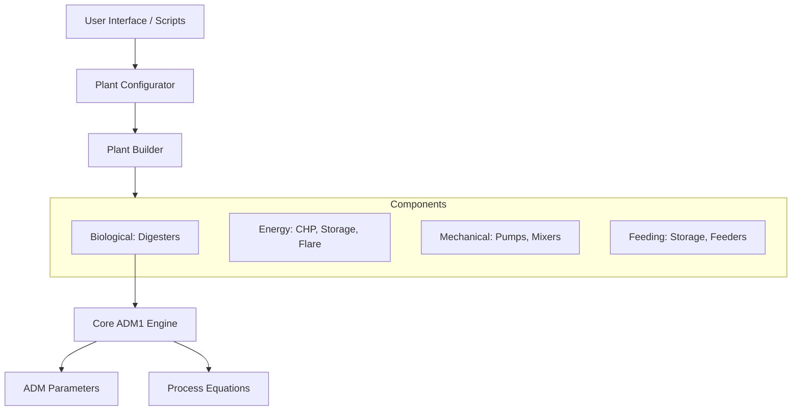
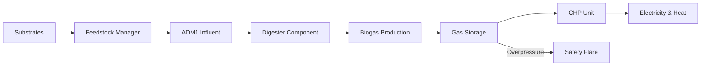
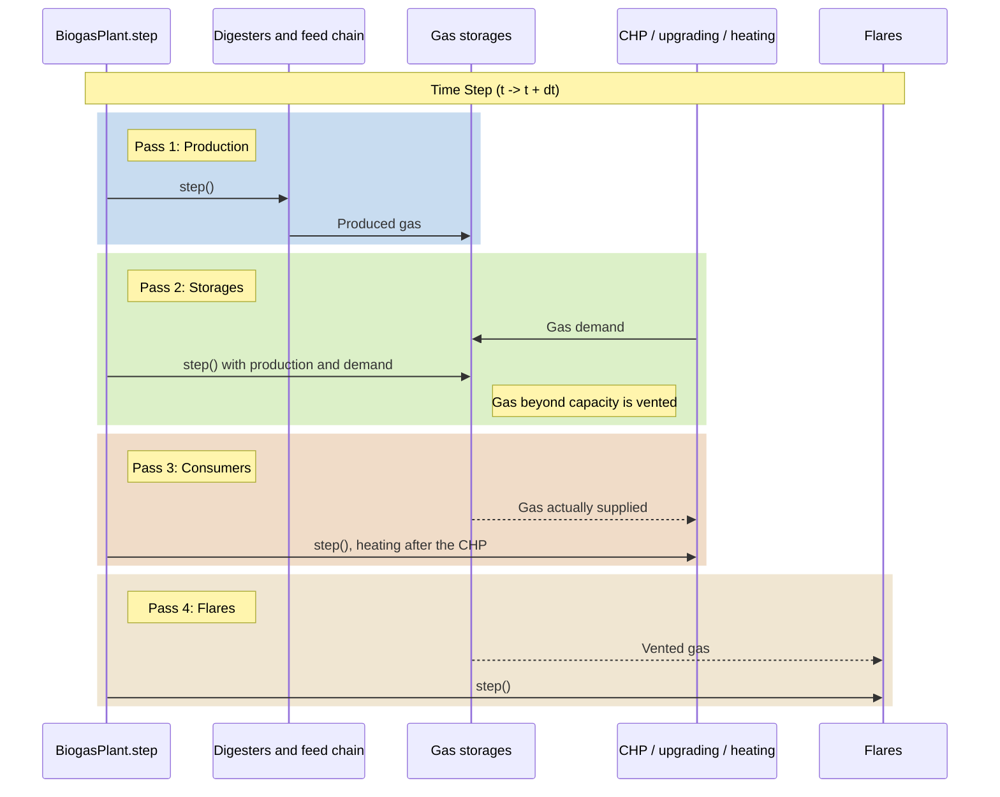

# Architecture

This page describes the system architecture and data flow of PyADM1ODE.

## System Overview

The framework is composed of several modular layers:

## Data Flow

## Four-Pass Simulation Step

Gas consumers depend on what the storages can supply, and heating systems on the
heat of the CHP. `BiogasPlant.step` therefore runs every time step in four
passes; each component is stepped exactly once.

