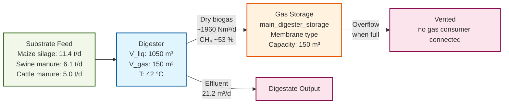

# Basic Digester Example

[](https://colab.research.google.com/github/dgaida/PyADM1ODE/blob/master/examples/colab_01_basic_digester.ipynb)

The example
[`examples/01_basic_digester.py`](https://github.com/dgaida/PyADM1ODE/blob/master/examples/01_basic_digester.py)
is the simplest PyADM1ODE configuration: a single digester fed with three
substrates, together with the gas storage the configurator creates for it.
The Colab notebook runs a shortened variant (two substrates, a larger
digester, 5 days), so its numbers differ from the ones on this page.

## System Architecture



## Overview

The example shows:

- Choosing substrates from the bundled library by ID and giving the mix as a dict `{substrate_id: feed rate}`  
- Building a single-digester plant with `PlantConfigurator`  
- The gas storage that `add_digester()` creates as a separate component  
- Starting from an initial state derived from the substrate mix, without a state file  
- Simulating 150 days in daily steps  
- Printing biogas, methane, methane content and pH for every tenth day  
- Saving the plant with its final state to JSON  

## Plant Configuration

| Component | ID | Settings |
| --- | --- | --- |
| Digester | `main_digester` | 1050 m³ liquid volume, 150 m³ gas headspace, 42 °C (315.15 K) |
| Gas storage | `main_digester_storage` | Membrane type, 150 m³ capacity; created by `add_digester()` |

The substrate feed is the `DEFAULT_FEED` of the script:

| Substrate ID | Material | Feed rate |
| --- | --- | --- |
| `maize_silage_milk_ripeness` | Maize silage (milk ripeness) | 11.4 t/d |
| `swine_manure` | Pig slurry | 6.1 t/d |
| `cattle_manure` | Cattle slurry | 5.0 t/d |
| Total | | 22.5 t/d |

**Unit of the feed rates**: With the default `Feedstock` convention
(`simba_q_convention=True`) the feed rates are tonnes of fresh matter per day
(t FM/d). For the two slurries (density 1000 kg/m³) a tonne is a cubic metre;
the 11.4 t/d of maize silage (density 1129 kg/m³) take up 10.1 m³/d. The
digester therefore receives
21.2 m³/d, and the hydraulic retention time is
1050 m³ ÷ 21.2 m³/d ≈ **49.5 d**. See
[Volumetric ADM1da convention for Q](../user_guide/adm1_implementation.md#volumetric-adm1da-convention-for-q).

**Gas storage**: The digester has no gas storage of its own; `V_gas` is only
the headspace of the ADM1 gas phase. `add_digester()` adds a separate
`GasStorage` component named `<digester_id>_storage`, here
`main_digester_storage`, and connects it to the digester with a gas
connection. Its capacity is `max(50, V_gas)`, here 150 m³. The example has no
CHP or other gas consumer, so nothing is drawn from the storage: it is full
after the first day and vents the whole production from then on (see
[Configuration Export](#configuration-export)). The component is described
under [Gas Storage](../user_guide/components/energy.md#gas-storage).

## Code Walkthrough

The excerpts are taken from the script.

### 1. Substrate Mix

```python
# Default substrate mix [t FM/d] — maize silage + swine + cattle manure.
DEFAULT_FEED: dict[str, float] = {
    "maize_silage_milk_ripeness": 11.4,
    "swine_manure": 6.1,
    "cattle_manure": 5.0,
}
```

Each key is the ID of a substrate file under
[`data/substrates/`](https://github.com/dgaida/PyADM1ODE/tree/master/data/substrates),
which is the file name without extension (see
[Example Substrates](../substrates/library.md)). Any number of substrates may
be listed. `main(feed=...)` accepts another mapping of the same form and
splits it into two lists:

```python
substrate_ids = list(feed.keys())
Q_substrates = list(feed.values())
```

### 2. Feedstock and Plant

```python
from pyadm1 import BiogasPlant, Feedstock
from pyadm1.configurator.plant_configurator import PlantConfigurator
```

```python
feedstock = Feedstock(substrate_ids, feeding_freq=24, total_simtime=160)
plant = BiogasPlant("ADM1 Basic Plant")
cfg = PlantConfigurator(plant, feedstock)
```

- `Feedstock` loads the listed substrates and computes the ADM1 influent from their laboratory values. `feeding_freq` is the time between feeding events in hours, `total_simtime` the length of its time grid in days.  
- `BiogasPlant` is the container for all components and their connections.  
- `PlantConfigurator` adds components with defaults and connects them.  

### 3. Digester

```python
cfg.add_digester(
    digester_id="main_digester",
    V_liq=1050.0,
    V_gas=150.0,
    T_ad=315.15,
    Q_substrates=Q_substrates,
    k_L_a=200.0,
)
plant.initialize()
```

| Argument | Value | Meaning |
| --- | --- | --- |
| `V_liq` | 1050 m³ | Liquid volume |
| `V_gas` | 150 m³ | Gas headspace |
| `T_ad` | 315.15 K | Operating temperature (42 °C) |
| `Q_substrates` | `[11.4, 6.1, 5.0]` | Feed rates, in the order of the substrate IDs |
| `k_L_a` | 200 d⁻¹ | Gas–liquid mass-transfer coefficient |

The volumes and the temperature equal the defaults of `add_digester()`, and
200 d⁻¹ is also the model default of `k_L_a`.

`add_digester()` does three things:

- It creates the digester and derives its initial state from the feedstock: a pre-inoculated state at pH 7 with active biomass, built for this substrate mix and feed rate. No state file is needed.  
- It creates the gas storage `main_digester_storage`.  
- It connects digester and storage with a gas connection.  

It returns the digester and a one-line description of the initial state; the
script does not use the return value. `plant.initialize()` initializes every
component that is not initialized yet.

### 4. Simulation

```python
results = plant.simulate(duration=150.0, dt=1.0, save_interval=1.0)
```

- `duration`: simulated time [d]  
- `dt`: plant time step [d]. In every step the digester is computed first, then the gas storage receives its production. Within the step the digester integrates the ADM1 equations with SciPy's BDF solver and an adaptive step size.  
- `save_interval`: spacing of the saved results [d]  

`results` holds 150 entries, one per day, with `time` from 1.0 to 150.0. Each
entry has the form `{"time": ..., "components": {component_id: outputs}}`.

### 5. Report

```python
times = np.array([r["time"] for r in results])
dig = [r["components"]["main_digester"] for r in results]
q_gas = np.array([c["Q_gas"] for c in dig])
q_ch4 = np.array([c["Q_ch4"] for c in dig])
pH = np.array([c["pH"] for c in dig])
```

`Q_gas` and `Q_ch4` are **dry gas at standard conditions** (0 °C,
1.01325 bar), in Nm³/d; the water vapour of the headspace is not part of
them. See
[Reported gas flows](../user_guide/adm1_implementation.md#reported-gas-flows).

```python
# The first saved result is the end of day 1; then every tenth day and the last.
for day in sorted({int(times[0]), *range(10, int(times[-1]) + 1, 10), int(times[-1])}):
    i = int(np.argmin(np.abs(times - day)))
    ch4p = q_ch4[i] / q_gas[i] * 100.0 if q_gas[i] > 0.0 else 0.0
    print(f"{day:>5d}  {q_gas[i]:>10.1f}  {q_ch4[i]:>10.1f}  {ch4p:>6.1f}  {pH[i]:>6.2f}")
```

The table has one row for the end of day 1, for every tenth day and for the
last day. The column `CH4%` is `Q_ch4 / Q_gas`, the methane content of the
dry gas. There is no result for day 0, because the first one is saved after
the first step.

### 6. Saving

```python
output_path = REPO_ROOT / "output"
output_path.mkdir(exist_ok=True)
plant.to_json(str(output_path / "quickstart_config.json"))

return plant, results
```

## Output

`python examples/01_basic_digester.py`, run from the repository root, prints
(rows for days 80 to 130 and the start of the path omitted):

```text
Substrate mix:
  maize_silage_milk_ripeness           11.40 t FM/d
  swine_manure                          6.10 t FM/d
  cattle_manure                         5.00 t FM/d
  TOTAL                                22.50 t FM/d

Simulated 100/150 steps
  Day      Biogas     Methane    CH4%      pH
--------------------------------------------------
    1      1765.6       870.0    49.3    7.38
   10      1894.4      1009.7    53.3    7.42
   20      1926.0      1026.3    53.3    7.43
   30      1943.8      1035.3    53.3    7.45
   40      1953.1      1039.5    53.2    7.46
   50      1957.4      1040.9    53.2    7.46
   60      1959.1      1040.9    53.1    7.46
   70      1959.7      1040.5    53.1    7.46
...
  140      1959.7      1039.2    53.0    7.45
  150      1959.7      1039.2    53.0    7.45
Plant configuration saved to ...\PyADM1ODE\output\quickstart_config.json
```

The line `Simulated 100/150 steps` is a progress message of
`plant.simulate()`.

## Interpreting the Output

| Quantity | Value at day 150 | Obtained from |
| --- | --- | --- |
| Biogas (dry) | 1959.7 Nm³/d | `Q_gas` |
| Methane | 1039.2 Nm³/d | `Q_ch4` |
| Methane content of the dry gas | 53.0 % | `Q_ch4 / Q_gas` |
| pH | 7.45 | `pH` |
| Biogas per tonne of fresh matter | 87.1 Nm³/t | 1959.7 Nm³/d ÷ 22.5 t/d |
| Methane per tonne of fresh matter | 46.2 Nm³/t | 1039.2 Nm³/d ÷ 22.5 t/d |

Course over the 150 days:

- **Start**: The first row (end of day 1) shows 1765.6 Nm³/d of biogas with 49.3 % methane. At day 10 the methane content is 53.3 %.  
- **Biogas**: It rises to 1959.7 Nm³/d by day 70 and stays there.  
- **Methane**: It reaches 1040.9 Nm³/d at day 50 and settles at 1039.2 Nm³/d. The methane content drifts from 53.3 % to 53.0 %.  
- **pH**: It rises from 7.38 to 7.46 and stays between 7.45 and 7.46 from day 30 on.  

### More Values in the Results

Every saved entry holds the complete output of both components. They can be
read at the end of `main()` or from its return value:

```python
last = results[-1]["components"]
digester = last["main_digester"]
storage = last["main_digester_storage"]

print(digester["VFA"], digester["TAC"], digester["HRT"])
print(storage["stored_volume_m3"], storage["vented_volume_m3"])
```

| Key | Meaning | Value at day 150 |
| --- | --- | --- |
| `Q_co2` | Carbon dioxide, dry [Nm³/d] | 920.5 |
| `VFA` | Volatile fatty acids [g HAc-eq/L] | 2.60 |
| `TAC` | Acid capacity [g CaCO₃/L] | 6.78 |
| `TS` | Total solids [% FM] | 10.6 |
| `HRT` | Filtered hydraulic retention time [d] | 47.1 |
| `Q_out` | Effluent [m³/d] | 21.2 |

`HRT` follows a first-order lag towards the 49.5 d given above and has
reached 47.1 d at day 150.

Gas flow and pH look settled after 70 days, the acids are not: VFA rises from
0.24 g/L at the end of day 1 to 1.96 g/L at day 100 and 2.60 g/L at day 150,
while TAC falls from 7.40 to 6.78 g CaCO₃/L. Within the 150 days the digester
has therefore not reached a full steady state. Typical operating ranges of
these indicators are listed under
[Process Monitoring](../user_guide/components/biological.md#process-monitoring).

## Configuration Export

`plant.to_json()` writes the structure of the plant and its state at the end
of the run to `output/quickstart_config.json`. Shortened, the file reads:

```json
{
  "plant_name": "ADM1 Basic Plant",
  ...
  "substrate_use": {
    "maize_silage_milk_ripeness": {
      "mass_t": 1710.000000000004,
      "cost": 68399.99999999999
    },
    ...
  },
  "simulation_time": 150.0,
  "components": [
    {
      "component_id": "main_digester",
      "component_type": "digester",
      "name": "main_digester",
      "V_liq": 1050.0,
      "V_gas": 150.0,
      "T_ad": 315.15,
      ...
      "calibration_parameters": {
        "k_L_a": 200.0
      },
      ...
      "state": {
        "adm1_state": [...],
        "Q_substrates": [
          11.4,
          6.1,
          5.0
        ],
        "Q_gas": 1959.7029555067936,
        "Q_ch4": 1039.157036397983,
        "Q_co2": 920.5338387696268,
        "pH": 7.452384393187586,
        "VFA": 2.599257770172284,
        "TAC": 6.775870356966873,
        "TS": 10.635918532942508,
        "HRT": 47.13833332586989,
        "V_liq": 1050.0
      },
      "component_class": "Digester"
    },
    {
      "component_id": "main_digester_storage",
      "component_type": "storage",
      "name": "main_digester Gas Storage",
      "storage_type": "membrane",
      "capacity_m3": 150.0,
      ...
      "stored_volume_m3": 150.0,
      "ch4_fraction": 0.5302625700153639,
      "co2_fraction": 0.4697312655990599,
      ...
      "cumulative_vented_m3": 291889.75429776055,
      "outputs_data": {
        "stored_volume_m3": 150.0,
        "pressure_bar": 1.05,
        "utilization": 1.0,
        "vented_volume_m3": 1959.7029555067938,
        "Q_gas_supplied_m3_per_day": 0.0,
        ...
      },
      ...
      "component_class": "GasStorage"
    }
  ],
  "connections": [
    {
      "from": "main_digester",
      "to": "main_digester_storage",
      "type": "gas"
    }
  ]
}
```

- `substrate_use` is the fresh matter fed over the run and its cost: 11.4 t/d × 150 d = 1710 t of maize silage.  
- `state` of the digester holds the 41 ADM1 state variables and the indicators of the last step.  
- The storage entry shows where the gas went: the storage is full (150 m³ of 150 m³), supplied nothing (`Q_gas_supplied_m3_per_day` is 0) and vented the production of the last day (1959.7 m³). Over the run it vented 291 890 m³ (`cumulative_vented_m3`).  

The file can be loaded again to continue from the saved state. The feedstock
is not stored in it and has to be passed in, with the substrates in the same
order:

```python
from pyadm1 import BiogasPlant, Feedstock

feedstock = Feedstock(
    ["maize_silage_milk_ripeness", "swine_manure", "cattle_manure"],
    feeding_freq=24,
    total_simtime=160,
)
plant = BiogasPlant.from_json("output/quickstart_config.json", feedstock)
```

## Adapting the Example

- **Substrate mix**: Edit `DEFAULT_FEED` or pass another dict to `main(feed=...)`. Entries can be added or removed; every key has to be a substrate ID of the [library](../substrates/library.md).  
- **Digester**: Change `V_liq`, `V_gas` or `T_ad` in `cfg.add_digester(...)`. `T_ad` is given in Kelvin.  
- **Duration and time step**: Change `duration`, `dt` and `save_interval` in `plant.simulate(...)`, for example `dt=1.0 / 24.0` for hourly plant steps.  
- **Further outputs**: Read VFA, TAC or the storage values from `results`, see [More Values in the Results](#more-values-in-the-results).  
- **Gas utilisation**: Add a CHP and a heating system, see [Two-Stage Plant](two_stage_plant.md) and [Energy Components](../user_guide/components/energy.md).  

## References

- **Batstone, D. J. et al. (2002).** *Anaerobic Digestion Model No. 1 (ADM1).* IWA Scientific and Technical Report No. 13. IWA Publishing, London.  
- **Schlattmann, M. (2011).** *Weiterentwicklung des Anaerobic Digestion Model No. 1 (ADM1) zur Anwendung auf landwirtschaftliche Substrate.* Dissertation, Technische Universität München. This is the ADM1da model the digester implements.  
- The complete list is on the [References](../user_guide/references.md) page.  

## Related Pages

- [Two-Stage Plant](two_stage_plant.md): two digesters in series with CHP and heating  
- [Parallel Simulation](parallel_simulation.md): many simulations of one digester side by side  
- [Biological Components](../user_guide/components/biological.md): parameters and outputs of the digester  
- [Energy Components](../user_guide/components/energy.md): gas storage, CHP, heating, flare  
- [ADM1 Implementation](../user_guide/adm1_implementation.md): the model behind the digester  
- [Troubleshooting](../user_guide/troubleshooting.md): common problems and their solutions  
