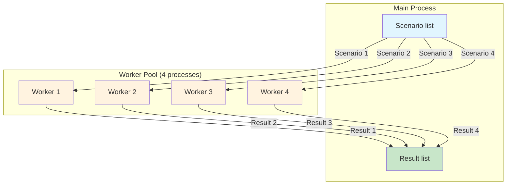

# Parallel Simulation Example

The [examples/05_parallel_two_stage_simulation.py](https://github.com/dgaida/PyADM1ODE/blob/master/examples/05_parallel_two_stage_simulation.py) example runs many simulations of one digester side by side: a comparison of four feed rates, a sweep over one kinetic parameter and a Monte Carlo analysis. All three use `ParallelSimulator` from `pyadm1.simulation.parallel`.

Despite its file name, the script simulates a single digester (one `ADM1` model), not a two-stage plant.

## Overview

The example shows:

- **Base model**: one `ADM1` model with two substrates that serves as the template for every scenario  
- **Parallel scenarios**: four feed rates, simulated in four worker processes  
- **Parameter sweep**: five values of the maximum acetate uptake rate `k_m_ac`, given as factors of the rate the model uses  
- **Monte Carlo analysis**: 50 random draws of `k_m_ac` from a normal distribution around that rate  
- **Summary statistics**: mean, standard deviation, minimum, maximum and median over the draws  

## Architecture



`run_scenarios` first checks the keys of every scenario and then starts a pool of `n_workers` processes. The base model object itself is not sent to the workers. The simulator sends its configuration instead:

- liquid volume, gas volume and temperature (`V_liq`, `V_gas`, `T_ad`)  
- the substrate parameters of the feedstock, its feeding frequency and its `Q` convention  
- the calibration parameters that are set on the base model  

Each worker builds its own `Feedstock` and `ADM1` from this configuration, applies the scenario on top, simulates `duration` days and returns a `ScenarioResult`. The results come back in the order of the scenario list.

## Running the Example

```bash
python examples/05_parallel_two_stage_simulation.py
```

The script takes no arguments, prints its results to the console and writes no files.

## Units

- **Feed rates** are tonnes of fresh matter per day [t FM/d] under the default `Feedstock` convention (`simba_q_convention=True`). The model converts them to volume flows with the density of each substrate: 11.4 t FM/d of maize silage are 10.1 m³/d at 1129 kg/m³, and 6.1 t FM/d of swine manure (1000 kg/m³) are 6.1 m³/d. See the section "Volumetric ADM1da convention for Q" in [ADM1 Implementation](../user_guide/adm1_implementation.md).  
- **Gas flows** (`Q_gas`, `Q_ch4`, `Q_co2`) are dry gas at standard conditions (0 °C, 1.01325 bar) in Nm³/d. See the section "Reported gas flows" on the same page.  

## Code Walkthrough

### 1. Base Model

```python
duration = 30.0  # days

feedstock = Feedstock(["maize_silage_milk_ripeness", "swine_manure"])
base_feed = [11.4, 6.1]  # t FM/d: maize silage, swine manure

adm1 = ADM1(feedstock, V_liq=1200.0, V_gas=216.0, T_ad=315.15)

initial_state = get_state_zero_from_csv(str(REPO_ROOT / "data" / "initial_states" / "digester_initial8.csv"))

# The workers rebuild the model from the configuration of this base model.
# The feed is not part of it: every scenario brings its own "Q".
parallel = ParallelSimulator(adm1, n_workers=4, verbose=True)
```

- `Feedstock`: maize silage and swine manure from the [substrate library](../substrates/library.md). A feed vector has one entry per substrate, in the order of this list.  
- `ADM1`: a digester with 1200 m³ liquid volume and 216 m³ gas volume at 315.15 K (42 °C).  
- `initial_state`: the 41 state variables from `data/initial_states/digester_initial8.csv`. Every scenario starts from this state.  
- `ParallelSimulator`: four worker processes. Without `n_workers` the simulator uses the number of CPU cores minus one. `verbose=True` prints the progress lines shown under [Output](#output).  

### 2. Feed-Rate Comparison

```python
feed_scenarios = [
    ("Low Feed", [8.0, 4.0]),
    ("Base Feed", base_feed),
    ("High Feed", [15.0, 8.0]),
    ("Very High Feed", [20.0, 10.0]),
]
scenarios = [{"Q": Q} for _, Q in feed_scenarios]

results = parallel.run_scenarios(
    scenarios=scenarios,
    duration=duration,
    initial_state=initial_state,
)
```

A scenario is a dictionary. These keys are allowed:

| Key | Meaning |
|-----|---------|
| `Q` | Feed rates per substrate [t FM/d] |
| `T_ad` | Digester temperature [K]; replaces the temperature of the base model for this scenario |
| `k_dis_PS`, `k_dis_PF`, `k_hyd_ch`, `k_hyd_pr`, `k_hyd_li` | Disintegration and hydrolysis rates |
| `k_m_su`, `k_m_aa`, `k_m_fa`, `k_m_c4`, `k_m_pro`, `k_m_ac`, `k_m_h2` | Maximum uptake rates |
| `k_p`, `k_L_a`, `K_H_co2`, `K_H_ch4`, `K_H_h2` | Gas outlet, gas-liquid transfer and Henry constants |

Any other key, for example `k_dis` or `Y_su`, raises a `ValueError` before a simulation starts. A misspelt name would otherwise be ignored, and every scenario of a sweep would return the same result.

Scenarios do not inherit a feed from the base model. A scenario without `Q` is simulated without feed, which is why the sweep and the Monte Carlo analysis below pass `Q` as a fixed parameter.

The other arguments of `run_scenarios`:

- `duration`: simulated time per scenario [d], here 30 days  
- `initial_state`: start state of every scenario  
- `compute_metrics`: computes the values listed under [Result Objects](#result-objects) from the final state (default `True`)  

### 3. Parameter Sweep

A rate given in a scenario replaces the rate of the model as it is. The model keeps `k_m_ac` at 8.0 d⁻¹ for 35 °C and corrects it to the operating temperature, which gives 11.76 d⁻¹ at the 42 °C of this example. The simulator applies no such correction to a scenario value. The script therefore reads the rate the model uses and builds the sweep from factors of it:

```python
K_M_AC_SWEEP_FACTORS = [0.15, 0.3, 0.5, 1.0, 1.5]
```

```python
k_m_ac_nominal = nominal_rate(adm1, "k_m_ac")
print(f"   k_m_ac of the model at {adm1.T_ad - 273.15:.0f} °C: {k_m_ac_nominal:.2f} 1/d")

sweep_config = ParameterSweepConfig(
    parameter_name="k_m_ac",
    values=[factor * k_m_ac_nominal for factor in K_M_AC_SWEEP_FACTORS],
    other_params={"Q": base_feed},
)

sweep_results = parallel.parameter_sweep(
    config=sweep_config,
    duration=duration,
    initial_state=initial_state,
)
```

`nominal_rate` is a small helper of the script. It returns a calibration value if one is set on the base model, and otherwise the rate corrected to the temperature of the base model:

```python
calibration = adm1.get_calibration_parameters()
if name in calibration:
    return float(calibration[name])
rates = ADMParams.apply_temperature_corrections(
    ADMParams.get_kinetic_params(),
    ADMParams.get_temperature_factors(),
    adm1.T_ad,
)
return float(rates[name])
```

`parameter_sweep` creates one scenario per value: a copy of `other_params` plus the swept parameter. Further keyword arguments are passed on to `run_scenarios`. The script then prints one row per successful scenario and names the one with the highest methane flow.

### 4. Monte Carlo Analysis

```python
K_M_AC_REL_STD = 0.10
```

```python
mc_config = MonteCarloConfig(
    n_samples=50,
    parameter_distributions={"k_m_ac": (k_m_ac_nominal, K_M_AC_REL_STD * k_m_ac_nominal)},
    fixed_params={"Q": base_feed},
    seed=42,
)

mc_results = parallel.monte_carlo(
    config=mc_config,
    duration=duration,
    initial_state=initial_state,
)
summary = parallel.summarize_results(mc_results)
```

- `parameter_distributions`: mean and standard deviation of a normal distribution per parameter, here the rate of the model and 10 % of it. Other distributions are not available, and the draws are not truncated, so choose mean and standard deviation such that the values stay physically meaningful.  
- `fixed_params`: keys that are the same in every sample  
- `seed`: seeds the random generator of NumPy, so every run draws the same 50 values  
- `summarize_results`: returns `n_scenarios`, `n_successful`, `n_failed` and `success_rate`, and under `metrics` the statistics `mean`, `std`, `min`, `max`, `median`, `q25` and `q75` for every metric over the successful scenarios. `std` is the population standard deviation (`np.std`).  

## Result Objects

Every scenario returns a `ScenarioResult`:

| Field | Content |
|-------|---------|
| `scenario_id` | Position in the scenario list, starting at 0 |
| `parameters` | The scenario dictionary |
| `success` | `True` if the simulation finished |
| `duration` | Simulated time [d] |
| `final_state` | State vector at the end (41 values) |
| `time_series` | Only with `save_time_series=True`: the last ten values of `Q_gas`, `Q_ch4` and `pH` (pH rounded to one decimal), stored once per `dt` step |
| `metrics` | Values computed from the final state, see below |
| `error` | Exception type, message and traceback of a failed scenario |
| `execution_time` | Wall-clock time of the scenario in its worker [s] |

`metrics` holds these values:

| Key | Unit | Meaning |
|-----|------|---------|
| `Q_gas` | Nm³/d | Dry biogas |
| `Q_ch4` | Nm³/d | Methane |
| `Q_co2` | Nm³/d | Carbon dioxide |
| `p_gas` | bar | Sum of the dry partial pressures of hydrogen, methane and carbon dioxide |
| `CH4_content` | - | `Q_ch4 / Q_gas`, the methane fraction of the dry gas |
| `pH` | - | pH from the charge balance |
| `Q_total` | t FM/d | Sum of the feed rates of the scenario as entered |
| `specific_gas_production` | Nm³/t FM | `Q_gas / Q_total` |
| `specific_ch4_production` | Nm³/t FM | `Q_ch4 / Q_total` |
| `HRT` | d | `V_liq` divided by the volume flow the model uses for this feed |

The units of `Q_total` and of the specific yields hold for the default `Feedstock` convention. The metrics contain no VFA, TAC or FOS/TAC values.

## Output

The blocks below are the output of one run; `...` marks omitted lines. The `Total time` lines are from that run on one PC and differ between machines and runs. The simulated values repeat from run to run, because the Monte Carlo draws are fixed by `seed=42`.

### Feed-Rate Comparison

```text
======================================================================
PyADM1 Parallel Simulation Example
======================================================================

1. Building base ADM1 model...  

2. Running feed-rate comparison...  
Starting parallel simulation with 4 scenarios
Using 4 worker processes
  Completed 4/4 scenarios

Simulation complete:
  Total scenarios: 4
  Successful: 4
  Failed: 0
  Total time: 3.6 seconds
  Average time per scenario: 0.90 seconds

   Feed-rate results (feed in t FM/d, gas flows in Nm³/d, HRT in d):
   ------------------------------------------------------------------
   Scenario           Feed     Q_gas     Q_ch4   CH4 %     pH     HRT
   Low Feed           12.0    1396.8     739.3    52.9   7.44   108.3
   Base Feed          17.5    1893.0    1003.7    53.0   7.44    74.1
   High Feed          23.0    2393.3    1270.0    53.1   7.43    56.4
   Very High Feed     30.0    3053.0    1620.1    53.1   7.42    43.3
```

- The gas flow rises with the feed, but less than proportionally: 2.5 times the feed (12.0 to 30.0 t FM/d) gives 2.19 times the gas, and the gas per tonne of fresh matter (`Q_gas / Q_total`) falls from 116.4 to 101.8 Nm³.  
- The methane content of the dry gas stays at about 53 % in all four scenarios, and the pH moves only from 7.44 to 7.42.  
- The retention time is longer than `V_liq` divided by the feed in tonnes, because the silage takes less than 1 m³ per tonne: the Base Feed of 17.5 t FM/d is a volume flow of 16.2 m³/d, which gives 74.1 d.  
- The values describe day 30, not a steady state. All scenarios start from the same initial state, and 30 days are shorter than every retention time in the table.  

### Parameter Sweep

```text
3. Parameter sweep over k_m_ac...  
   k_m_ac of the model at 42 °C: 11.76 1/d
Parameter sweep: k_m_ac
  Values: [1.7635371857293733, 3.5270743714587467, 5.878457285764578, 11.756914571529157, 17.635371857293734]
Starting parallel simulation with 5 scenarios
Using 4 worker processes
  Completed 5/5 scenarios

Simulation complete:
  Total scenarios: 5
  Successful: 5
  Failed: 0
  Total time: 2.6 seconds
  Average time per scenario: 0.51 seconds

   Sweep results (k_m_ac in 1/d, gas flows in Nm³/d):
   ------------------------------------------------------------------
   Factor   k_m_ac     Q_gas     Q_ch4   CH4 %     pH
     0.15     1.76    1009.4       9.1     0.9   4.50
     0.30     3.53    1855.3     968.7    52.2   7.13
     0.50     5.88    1873.4     985.2    52.6   7.36
     1.00    11.76    1893.0    1003.7    53.0   7.44
     1.50    17.64    1894.3    1005.0    53.1   7.44

   Highest methane flow: 1005.0 Nm³/d at k_m_ac = 17.64 1/d (factor 1.50)
```

- At factor 0.15 (1.76 d⁻¹) the digester has acidified after 30 days: the pH is 4.50, and methane makes up only 9.1 of the 1009.4 Nm³/d of gas (0.9 %).  
- From factor 0.30 to factor 1.00 the methane flow rises by 3.6 %, from 968.7 to 1003.7 Nm³/d, and the pH from 7.13 to 7.44.  
- Factor 1.00 is the rate of the model, so its row equals the Base Feed row of the feed-rate comparison.  
- Above the rate of the model little changes: factor 1.50 adds 1.3 Nm³/d. The highest methane flow is therefore the upper end of the sweep, not an optimum inside it.  

### Monte Carlo Analysis

```text
4. Monte Carlo uncertainty (50 samples)...  
Monte Carlo simulation:
  Samples: 50
  Parameters with uncertainty:
    k_m_ac: N(11.756914571529157, 1.1756914571529158²)
Starting parallel simulation with 50 scenarios
Using 4 worker processes
  Completed 10/50 scenarios
...
  Completed 50/50 scenarios

Simulation complete:
  Total scenarios: 50
  Successful: 50
  Failed: 0
  Total time: 5.0 seconds
  Average time per scenario: 0.10 seconds

   Success rate: 100.0%
   k_m_ac draws [1/d]: 9.45 to 13.93

   Methane production [Nm³/d]:
     mean ± std : 1003.4 ± 0.7
     min  / max : 1001.7 / 1004.4
     median     : 1003.6

======================================================================
Parallel demonstration completed successfully!
======================================================================
```

- The 50 draws of `k_m_ac` lie between 9.45 and 13.93 d⁻¹. All 50 scenarios finished.  
- The methane flow is 1003.4 ± 0.7 Nm³/d and lies between 1001.7 and 1004.4 Nm³/d.  
- The standard deviation of the parameter is 10 % of its mean, that of the methane flow 0.07 % (0.7 / 1003.4). Around the rate of the model the methane flow after 30 days reacts only weakly to `k_m_ac`, which matches the flat upper part of the sweep.  
- The script prints the statistics of `Q_ch4` only. `summary["metrics"]` holds the same statistics, and the quartiles `q25` and `q75`, for every metric.  

## Adapting the Example

- **Other parameters**: every key of the table in [step 2](#2-feed-rate-comparison) can be used in a scenario, as `parameter_name` of a sweep or in `parameter_distributions`. `nominal_rate` returns the rate of the model for the `k_dis_*`, `k_hyd_*` and `k_m_*` keys.  
- **Temperature**: add `T_ad` in kelvin to a scenario, for example `{"Q": base_feed, "T_ad": 311.15}`. All scenarios of one call can have different temperatures.  
- **Time series**: pass `save_time_series=True` and a step `dt` in days to `run_scenarios`, `parameter_sweep` or `monte_carlo`. Each result then carries the last ten stored values of `Q_gas`, `Q_ch4` and `pH`. Without `save_time_series=True`, `dt` has no effect.  
- **Calibrated base model**: parameters set with `adm1.set_calibration_parameters({...})` on the base model apply to every scenario. A scenario value for the same parameter takes precedence.  
- **Substrates and digester size**: change the substrate list of `Feedstock` and the arguments of `ADM1`. The feed vectors follow the order of the substrate list.  
- **Number of workers**: set `n_workers`. Every call of `run_scenarios` starts its own pool. With `n_workers=1` or a single scenario the simulator runs in the main process and starts no pool.  
- **Failed scenarios**: a scenario that raises an exception does not stop the others. Its result has `success=False` and the reason in `error`.  

Several parameters can be varied at once with `multi_parameter_sweep`, which the script does not use. It simulates every combination of the given values:

```python
results = parallel.multi_parameter_sweep(
    parameter_configs={"k_m_ac": [3.5, 8.0], "T_ad": [311.15, 315.15]},
    duration=duration,
    initial_state=initial_state,
    fixed_params={"Q": base_feed},
)
```

This gives 2 × 2 = 4 scenarios. In the result list the last parameter changes fastest: `(3.5, 311.15)`, `(3.5, 315.15)`, `(8.0, 311.15)`, `(8.0, 315.15)`.

In your own scripts, keep the call inside a `main()` function behind `if __name__ == "__main__":`, as the example does. The workers are started with the `spawn` method (`forkserver` on Linux), which imports the main module again in every worker; see the Python documentation on [multiprocessing](https://docs.python.org/3/library/multiprocessing.html). The environment variable `PYADM1_MP_START_METHOD` selects another start method.

## Related Examples

- [`basic_digester.md`](basic_digester.md): Single digester simulation basics  
- [`two_stage_plant.md`](two_stage_plant.md): Two-stage plant configuration  
- [examples/06_parallel_operation_studies.py](https://github.com/dgaida/PyADM1ODE/blob/master/examples/06_parallel_operation_studies.py): Three larger studies with the same simulator and three substrates (maize silage, cattle manure, grass silage): a grid of 54 feed scenarios over retention time and organic loading rate, 66 substrate mixes at a constant total feed, and ten temperatures through the scenario key `T_ad`. It saves one figure per study to `output/`.  
- [Simulation API](../api/simulation.md): Reference of `ParallelSimulator`, `ScenarioResult`, `ParameterSweepConfig` and `MonteCarloConfig`  

## Summary

1. **One base model, many scenarios**: `ParallelSimulator` sends the configuration of the base model to worker processes, and every scenario changes the feed, the temperature or calibration parameters on top of it.  
2. **Three ways to build scenarios**: an explicit list (`run_scenarios`), one parameter over several values (`parameter_sweep`) and random draws from normal distributions (`monte_carlo`).  
3. **Results as numbers**: every scenario returns its final state and metrics such as dry gas flows in Nm³/d, methane content and pH; `summarize_results` condenses them into statistics.  
