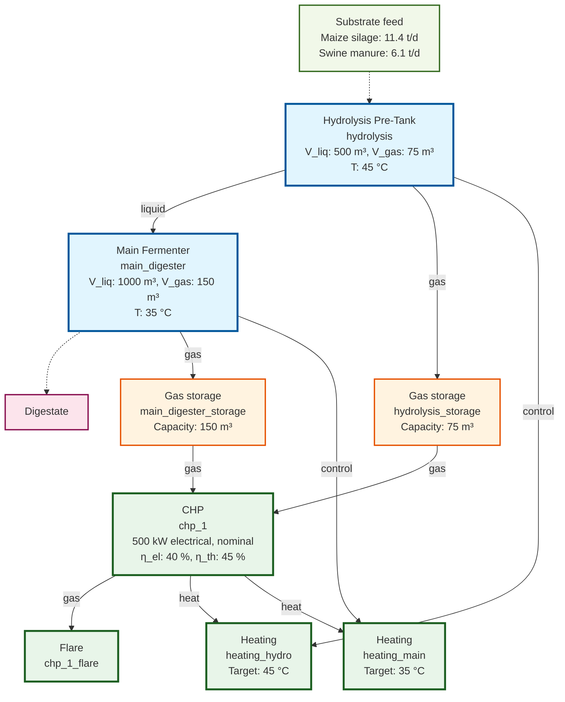

# Two-Stage Biogas Plant Example

[](https://colab.research.google.com/github/dgaida/PyADM1ODE/blob/master/examples/colab_02_complex_plant.ipynb)

The [examples/02_two_stage_plant.py](https://github.com/dgaida/PyADM1ODE/blob/master/examples/02_two_stage_plant.py)
example builds a two-stage biogas plant: a hydrolysis pre-tank and a main
fermenter in series, one CHP unit with a flare, and one heating system per
stage. It simulates ten days and prints the final state of both tanks.

The Colab notebook builds the same plant with other component IDs and a shorter
run (5 days in daily steps), so its numbers differ from the ones on this page.

## Overview

The example shows:

- Two ADM1 digesters in series, joined by a liquid connection  
- The gas storage that `add_digester` creates for each digester  
- One CHP unit fed from both gas storages, with its automatically created flare  
- One heating system per stage, tied to its digester and supplied with heat from the CHP  
- Saving the plant to a JSON file  

## System Architecture



The diagram shows the eight components and ten connections that the plant
summary in the output below lists; the arrow labels are the connection types.
A `control` connection hands the temperature and the feed of a digester to its
heating system. The dashed arrows are not connections: the substrate feed is
set as `Q_substrates` on the pre-tank, and the digestate is the effluent of the
main fermenter. The flare is connected behind the CHP; it burns the gas that
the gas storages vent.

## Plant Configuration

### Digesters

| Property              | Hydrolysis pre-tank                         | Main fermenter              |
|-----------------------|---------------------------------------------|-----------------------------|
| Component ID          | `hydrolysis`                                | `main_digester`             |
| Liquid volume `V_liq` | 500 m³                                      | 1000 m³                     |
| Gas headspace `V_gas` | 75 m³                                       | 150 m³                      |
| Temperature `T_ad`    | 318.15 K (45 °C)                            | 308.15 K (35 °C)            |
| Substrate feed        | 11.4 t/d maize silage, 6.1 t/d swine manure | None                        |
| Inflow                | 16.2 m³/d of substrate                      | 16.2 m³/d from the pre-tank |
| Retention time        | 30.9 d                                      | 61.7 d                      |

The feed rates are tonnes of fresh matter per day, 17.5 t/d in total. The
feedstock converts them to a volume flow with the density of each substrate:
11.4 t/d of maize silage at 1129 kg/m³ are 10.1 m³/d, and swine manure counts
with 1000 kg/m³. Together this gives 16.2 m³/d (see
[Volumetric ADM1da convention for Q](../user_guide/adm1_implementation.md#volumetric-adm1da-convention-for-q)).
The retention time is the liquid volume divided by this flow. The script takes
the flow from `feedstock.actual_Q` and prints the rounded retention times, 31 d
and 62 d, in its start banner.

### Gas and Energy Components

| Component                   | ID                      | Created by     | Settings                                                     |
|-----------------------------|-------------------------|----------------|--------------------------------------------------------------|
| Gas storage, pre-tank       | `hydrolysis_storage`    | `add_digester` | Membrane storage, capacity 75 m³                             |
| Gas storage, main fermenter | `main_digester_storage` | `add_digester` | Membrane storage, capacity 150 m³                            |
| CHP                         | `chp_1`                 | `add_chp`      | 500 kW electrical (nominal), `eta_el=0.40`, `eta_th=0.45`    |
| Flare                       | `chp_1_flare`           | `add_chp`      | Destruction efficiency 0.98                                  |
| Heating, pre-tank           | `heating_hydro`         | `add_heating`  | Target 318.15 K, tied to `hydrolysis`, 0.5 kW/K heat loss    |
| Heating, main fermenter     | `heating_main`          | `add_heating`  | Target 308.15 K, tied to `main_digester`, 0.5 kW/K heat loss |

A digester holds no gas itself: `V_gas` is the headspace of the ADM1 gas phase,
and the gas that leaves it goes into the separate `GasStorage` component
`<digester_id>_storage`. The capacity of that storage is `V_gas`, but at least
50 m³. The destruction efficiency of the flare and the heat loss coefficient of
0.5 kW/K are package defaults; the script does not set them.

## Code Walkthrough

The excerpts are taken from the script; most `print` calls are left out.

### 1. Feedstock and Feed Rates

```python
feedstock = Feedstock(["maize_silage_milk_ripeness", "swine_manure"])

# Substrate feed in t FM/d, one slot per substrate of the feedstock:
# hydrolysis stage gets fresh substrate, main stage inherits.
hydro_feed = [11.4, 6.1, 0, 0, 0, 0, 0, 0, 0, 0]
main_feed = [0.0] * 10

# The model works with the volume flow of the feed [m³/d]: the feedstock
# converts the mass flows with the density of each substrate.
q_feed = sum(feedstock.actual_Q(hydro_feed))
```

- The order of the substrate IDs defines the slots of the feed lists: slot 0 is maize silage (milk ripeness), slot 1 is swine manure, the other slots stay at zero. The bundled substrates are listed under [Example Substrates](../substrates/library.md).  
- The feed rates are tonnes of fresh matter per day.  
- `main_feed` holds only zeros: the main fermenter gets no substrate of its own, only the effluent of the pre-tank.  
- `feedstock.actual_Q` returns the volume flow of each substrate. Their sum `q_feed` is the 16.2 m³/d the model works with.  

### 2. Two Digesters

```python
plant = BiogasPlant("Two-Stage Plant (ADM1 / SIMBA# biogas)")
cfg = PlantConfigurator(plant, feedstock)

# Hydrolysis pre-tank — 45 °C, between the mesophilic and the thermophilic range
hydro_digester, _ = cfg.add_digester(
    digester_id="hydrolysis",
    V_liq=500.0,
    V_gas=75.0,
    T_ad=318.15,
    name="Hydrolysis Pre-Tank",
    Q_substrates=hydro_feed,
)
hrt_hydro = hydro_digester.V_liq / q_feed

# Main methanogenesis fermenter — larger volume, mesophilic.
# Its inflow is the effluent of the pre-tank, which has the same volume flow.
main_digester, _ = cfg.add_digester(
    digester_id="main_digester",
    V_liq=1000.0,
    V_gas=150.0,
    T_ad=308.15,
    name="Main Fermenter",
    Q_substrates=main_feed,
)
hrt_main = main_digester.V_liq / q_feed
```

- Both stages use the same `Digester` class. There is no separate hydrolysis model; volume, temperature and feed decide what happens in a tank.  
- No initial-state file is needed: `add_digester` derives the initial state of each tank from the feedstock and the feed rates.  
- Each call also creates the gas storage `<digester_id>_storage` and connects the digester to it.  
- `add_digester` returns the digester. The script divides its liquid volume by `q_feed` to get the retention time for the start banner.  

### 3. CHP, Flare and Heating

```python
# CHP + heating. digester_id ties each heating system to its digester, so
# its heat demand covers the heat loss of the tank and warming the feed.
cfg.add_chp(chp_id="chp_1", P_el_nom=500.0, eta_el=0.40, eta_th=0.45)
cfg.add_heating(
    heating_id="heating_hydro",
    target_temperature=318.15,
    name="Hydrolysis Heating",
    digester_id="hydrolysis",
)
cfg.add_heating(
    heating_id="heating_main",
    target_temperature=308.15,
    name="Main Stage Heating",
    digester_id="main_digester",
)
```

- `add_chp` also creates the flare `chp_1_flare` and connects it behind the CHP.  
- `digester_id` adds a `control` connection from the digester to the heating system. The heating system then receives the temperature and the substrate feed of the digester, and its heat demand is the heat loss plus the heat for warming the feed.  
- The digesters define no k-values, so the heat loss uses the default coefficient: 0.5 kW/K × (digester temperature − ambient temperature).  
- `target_temperature` of a heating system is not linked to `T_ad` of the digester; the script sets both to the same value.  

### 4. Connections

```python
cfg.connect("hydrolysis", "main_digester", "liquid")
cfg.auto_connect_digester_to_chp("hydrolysis", "chp_1")
cfg.auto_connect_digester_to_chp("main_digester", "chp_1")
cfg.auto_connect_chp_to_heating("chp_1", "heating_hydro")
cfg.auto_connect_chp_to_heating("chp_1", "heating_main")

plant.initialize()
print(plant.get_summary())
```

- The liquid connection passes the effluent of the pre-tank, flow and composition, to the main fermenter.  
- `auto_connect_digester_to_chp` connects the gas storage of the digester to the CHP, not the digester itself.  
- `auto_connect_chp_to_heating` adds a heat connection. The heat of the CHP is split equally between the heating systems connected to it.  

### 5. Simulation

```python
duration = 10.0
dt = 1.0 / 24.0
results = plant.simulate(duration=duration, dt=dt, save_interval=1.0)
```

The run takes 240 steps of one hour. `results` holds eleven entries: one after
the first step and one per full day. Each entry has the keys `time` and
`components`; `components` maps every component ID to the outputs of that
component.

### 6. Final State and JSON Export

```python
final = results[-1]
h = final["components"]["hydrolysis"]
m = final["components"]["main_digester"]

total_gas = h["Q_gas"] + m["Q_gas"]
total_ch4 = h["Q_ch4"] + m["Q_ch4"]
```

The script prints `Q_gas`, `Q_ch4`, `pH`, `VFA` and `TAC` of both digesters and
the sums of the two gas flows. It then saves the plant:

```python
output_path = REPO_ROOT / "output"
output_path.mkdir(exist_ok=True)
plant.to_json(str(output_path / "two_stage_plant_config.json"))
```

`BiogasPlant.from_json(path, feedstock)` rebuilds the plant from this file. The
feedstock has to be passed again because the file does not contain it.

## Gas Handling in One Plant Step

`plant.simulate` calls `BiogasPlant.step()` once per time step. A step runs
every component once, in this order:

1. The digesters: first the pre-tank, then the main fermenter with the effluent the pre-tank produced in the same step.  
2. The gas storages: each storage takes in the gas its digester produced in this step, supplies the CHP, and only then vents what exceeds its capacity to the flare.  
3. The CHP with the gas the storages supplied, then the heating systems with the heat of the CHP.  
4. The flare with the gas the storages vented.  

The CHP asks for the gas it needs at full load and spreads this demand equally
over the two storages. Because supply and venting are settled within the same
step, the vented volume does not depend on the step length. See
[Gas Balance in a Plant](../user_guide/components/energy.md#gas-balance-in-a-plant).

## Output

Run the script from the repository root:

```bash
python examples/02_two_stage_plant.py
```

It prints the following; only the absolute path in the last line is shortened
to `...`:

```text
======================================================================
PyADM1 Two-Stage Plant Example
======================================================================

Building plant components...
  - Hydrolysis pre-tank: 500 m³ liquid @ 45 °C (HRT about 31 d)  
  - Main fermenter:   1000 m³ liquid @ 35 °C (HRT about 62 d)  
  - CHP: 500 kW_el, eta_el=40%, eta_th=45%  

Connecting components...
=== Two-Stage Plant (ADM1 / SIMBA# biogas) ===
Simulation time: 0.00 days

Components (8):
  - Hydrolysis Pre-Tank (digester)  
  - Hydrolysis Pre-Tank Gas Storage (storage)  
  - Main Fermenter (digester)  
  - Main Fermenter Gas Storage (storage)  
  - chp_1 (chp)  
  - chp_1_flare (flare)  
  - Hydrolysis Heating (heating)  
  - Main Stage Heating (heating)  

Connections (10):
  - Hydrolysis Pre-Tank -> Hydrolysis Pre-Tank Gas Storage (gas)  
  - Main Fermenter -> Main Fermenter Gas Storage (gas)  
  - chp_1 -> chp_1_flare (gas)  
  - Hydrolysis Pre-Tank -> Hydrolysis Heating (control)  
  - Main Fermenter -> Main Stage Heating (control)  
  - Hydrolysis Pre-Tank -> Main Fermenter (liquid)  
  - Hydrolysis Pre-Tank Gas Storage -> chp_1 (gas)  
  - Main Fermenter Gas Storage -> chp_1 (gas)  
  - chp_1 -> Hydrolysis Heating (heat)  
  - chp_1 -> Main Stage Heating (heat)  

Simulating 10 days at dt=1.0 h...
Simulated 100/240 steps
Simulated 200/240 steps

======================================================================
Final state (day 10.0):
======================================================================

Hydrolysis pre-tank:
  Biogas:      1679.0 Nm³/d
  Methane:      891.1 Nm³/d
  pH:            7.42
  VFA:           0.24 g HAc-eq/L
  TAC:           5.73 g CaCO3/L

Main fermenter:
  Biogas:       216.6 Nm³/d
  Methane:      114.0 Nm³/d
  pH:            7.39
  VFA:           0.03 g HAc-eq/L
  TAC:           6.30 g CaCO3/L

Plant total:
  Biogas:      1895.6 Nm³/d
  Methane:     1005.1 Nm³/d
  CH4 frac.:     53.0 %
Plant configuration saved to .../output/two_stage_plant_config.json
```

## Interpretation

### Final State on Day 10

| Quantity                       | Hydrolysis pre-tank | Main fermenter | Plant  |
|--------------------------------|---------------------|----------------|--------|
| Biogas, dry [Nm³/d]            | 1679.0              | 216.6          | 1895.6 |
| Methane [Nm³/d]                | 891.1               | 114.0          | 1005.1 |
| Methane content of the dry gas | 53.1 %              | 52.6 %         | 53.0 % |
| Share of the plant's methane   | 88.7 %              | 11.3 %         | 100 %  |
| pH                             | 7.42                | 7.39           | –      |
| VFA [g HAc-eq/L]               | 0.24                | 0.03           | –      |
| TAC [g CaCO3/L]                | 5.73                | 6.30           | –      |
| VFA/TAC                        | 0.04                | 0.005          | –      |

**Gas flows are dry gas at standard conditions.** `Q_gas` and `Q_ch4` are given
in Nm³/d (0 °C, 1.01325 bar) and contain no water vapour. The methane content
of 53.0 % is therefore that of the dry gas, which is what a gas analyser shows.
See [Reported gas flows](../user_guide/adm1_implementation.md#reported-gas-flows).

**The pre-tank produces most of the gas.** 891.1 of the 1005.1 Nm³/d of methane
(88.7 %) come from the first tank. With a retention time of 30.9 d, a pH of
7.42 and 0.24 g HAc-eq/L of VFA it runs the complete degradation chain down to
methane. In this configuration it is not a separate acidification stage. The
main fermenter digests what is left and adds 114.0 Nm³/d of methane.

**Acids and buffer capacity.** The VFA are 0.24 and 0.03 g HAc-eq/L at a TAC of
5.73 and 6.30 g CaCO3/L, which gives VFA/TAC ratios of 0.04 and 0.005. The pH
is 7.42 and 7.39. Typical ranges of these indicators are listed under
[Optimal Operating Ranges](../user_guide/components/biological.md#optimal-operating-ranges).

**Yield per tonne of feed.** The 17.5 t/d of fresh matter give 108 Nm³ of
biogas and 57 Nm³ of methane per tonne on day 10.

### Further Results

`main()` returns the plant and the result list. The outputs of the other
components can be read from them, for example:

```python
plant, results = main()
final = results[-1]["components"]

chp = final["chp_1"]
print(f"CHP electrical power:  {chp['P_el']:6.1f} kW")
print(f"CHP thermal power:     {chp['P_th']:6.1f} kW")
print(f"CHP gas consumption:   {chp['Q_gas_consumed']:6.1f} Nm³/d")

for storage_id in ("hydrolysis_storage", "main_digester_storage"):
    storage = final[storage_id]
    print(f"{storage_id}: {storage['stored_volume_m3']:.1f} m³ stored, {storage['cumulative_vented_m3']:.1f} m³ vented")
print(f"chp_1_flare: {final['chp_1_flare']['cumulative_vented_m3']:.1f} m³ burnt")

for heating_id in ("heating_hydro", "heating_main"):
    heating = final[heating_id]
    print(f"{heating_id}: {heating['Q_heat_supplied']:.1f} kW supplied, {heating['P_aux_heat']:.1f} kW auxiliary heat")

balance = plant.get_electricity_balance()
print(f"Net electrical power:  {balance['P_el_net']:6.1f} kW")
```

```text
CHP electrical power:   167.5 kW
CHP thermal power:      188.4 kW
CHP gas consumption:   1895.6 Nm³/d
hydrolysis_storage: 0.0 m³ stored, 0.0 m³ vented
main_digester_storage: 0.0 m³ stored, 0.0 m³ vented
chp_1_flare: 0.0 m³ burnt
heating_hydro: 37.6 kW supplied, 0.0 kW auxiliary heat
heating_main: 10.0 kW supplied, 0.0 kW auxiliary heat
Net electrical power:   162.5 kW
```

**The CHP runs at one third of its nominal power.** 1005.1 Nm³/d of methane at
10 kWh/Nm³ are 418.8 kW of fuel power. With the electrical efficiency of 0.40
this gives 167.5 kW, 33.5 % of the nominal 500 kW. The thermal power is
167.5 kW × 0.45 / 0.40 = 188.4 kW. At full load the CHP would need 3000 Nm³/d
of methane, about three times the production.

**The storages stay empty and the flare is not used.** The CHP can burn more
gas than the digesters produce, so it takes all the gas of every step: its
consumption of 1895.6 Nm³/d equals the production. Both storages are empty at
the end of the step, and nothing is vented.

**The heat demand is heat loss plus feed warming.** The pre-tank needs 37.6 kW:
0.5 kW/K × (45 °C − 15 °C) = 15.0 kW of heat loss and 22.6 kW for warming the
17.5 t/d of feed to 45 °C. The substrates enter at their storage temperatures,
9.3 °C for the maize silage and 20 °C for the swine manure. The main fermenter
needs 0.5 kW/K × (35 °C − 15 °C) = 10.0 kW. It has no substrate feed, and the
inflow from the pre-tank is not part of the heat balance. 15 °C is the default
ambient temperature of `BiogasPlant`. The 188.4 kW of CHP heat cover the
47.6 kW, so no auxiliary heat is needed.

**Net power.** The CHP uses 3 % of its output for its own auxiliaries (package
default). The plant has no other electricity consumers, which leaves 162.5 kW.

The course over the ten days shows how far the plant is from a steady state:

```python
print("  day  pre-tank     main  CH4 %  CHP kW")
for r in results:
    c = r["components"]
    q_gas = c["hydrolysis"]["Q_gas"] + c["main_digester"]["Q_gas"]
    q_ch4 = c["hydrolysis"]["Q_ch4"] + c["main_digester"]["Q_ch4"]
    print(
        f"{r['time']:5.2f} {c['hydrolysis']['Q_gas']:9.1f} {c['main_digester']['Q_gas']:8.1f}"
        f" {100 * q_ch4 / q_gas:6.1f} {c['chp_1']['P_el']:7.1f}"
    )
```

```text
  day  pre-tank     main  CH4 %  CHP kW
 0.04    1814.4   1646.7   22.1   181.6
 1.00    1527.1    104.2   49.6   134.9
 2.00    1586.6    129.6   51.4   146.9
...
 9.00    1674.0    207.5   53.0   166.2
10.00    1679.0    216.6   53.0   167.5
```

The columns `pre-tank` and `main` are the biogas flows in Nm³/d. The first row
is the state after the first hour: the tanks start from the derived initial
state, the gas holds only 22.1 % methane, and the CHP also burns the initial
filling of the storages (10 % of their capacity). From day 1 on the gas flow of
the main fermenter rises from 104.2 to 216.6 Nm³/d and still gains 9.1 Nm³/d on
the last day; the pre-tank gains 5.0 Nm³/d on that day. Ten days are a start-up
phase at retention times of 30.9 and 61.7 d, so the final state above is not a
steady state.

## Adapting the Example

- **Feed**: change the rates in `hydro_feed` (t/d of fresh matter) or pass other substrate IDs to `Feedstock`; see [Example Substrates](../substrates/library.md).  
- **Stage sizes and temperatures**: change `V_liq`, `V_gas` and `T_ad` in `add_digester`. A smaller `V_liq` of the pre-tank shortens its retention time. Set `target_temperature` of the matching heating system to the new `T_ad`.  
- **Simulation length**: change `duration` in `plant.simulate` to follow the plant beyond the start-up phase.  
- **CHP**: change `P_el_nom`, `eta_el` and `eta_th` in `add_chp`.  
- **Heat demand**: set `heat_loss_coefficient` in `add_heating`, or give the digesters the k-values `k_wall`, `k_roof` and `k_ground` in `add_digester` so that the heat loss follows the tank surfaces. The ambient temperature is `T_ambient` of `BiogasPlant`. See [Heating System](../user_guide/components/energy.md#heating-system).  
- **More components**: mixers, substrate storages and feeders are added with `add_mixer`, `add_substrate_storage` and `add_feeder`; see [Mechanical Components](../user_guide/components/mechanical.md) and [Feeding Components](../user_guide/components/feeding.md).  
- **Many scenarios**: see [Parallel Simulation](parallel_simulation.md).  

## References

- **Two-stage digestion**: Simeonov, I., Chorukova, E., & Kabaivanova, L. (2025). *Two-stage anaerobic digestion for green energy production: A review*. Processes, 13(2), 294.  
- **Model**: [ADM1 Implementation](../user_guide/adm1_implementation.md)  
- **Components**: [Biological Components](../user_guide/components/biological.md), [Energy Components](../user_guide/components/energy.md)  

## Related Examples

- [Basic Digester](basic_digester.md): Single digester with gas storage  
- [Parallel Simulation](parallel_simulation.md): Running many simulation scenarios in parallel  
